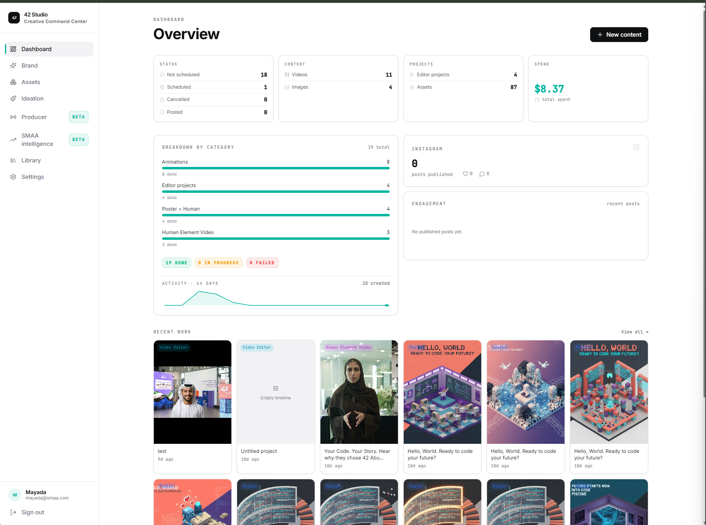
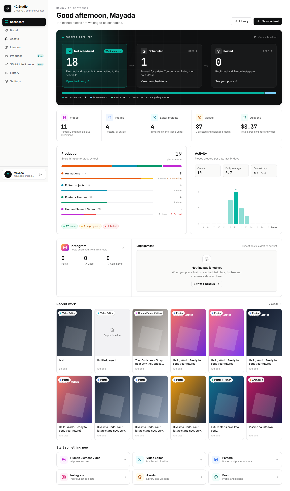
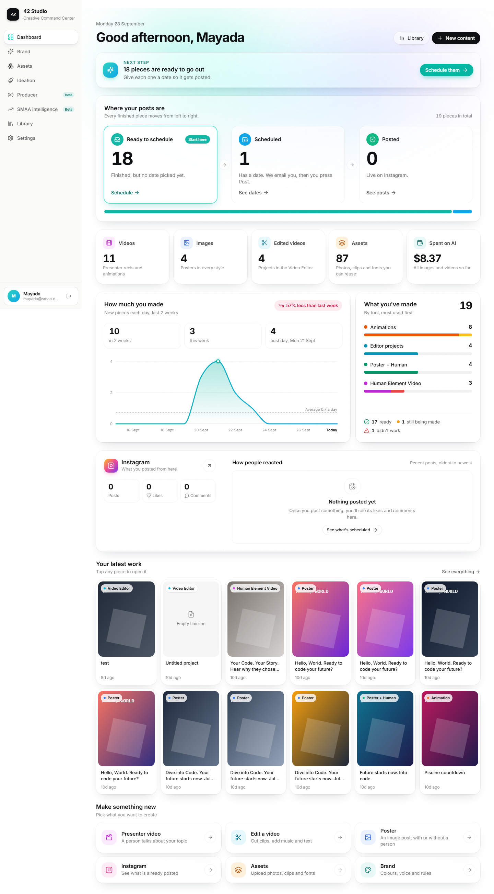
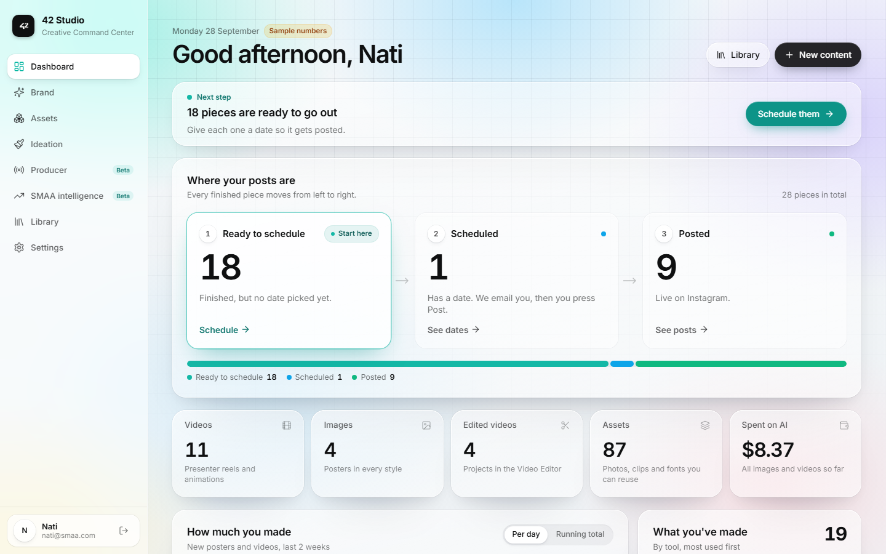
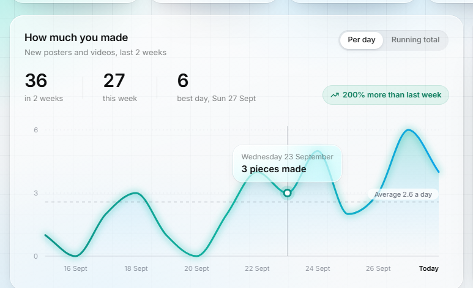
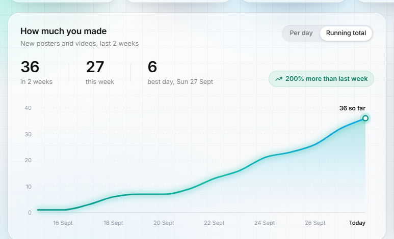
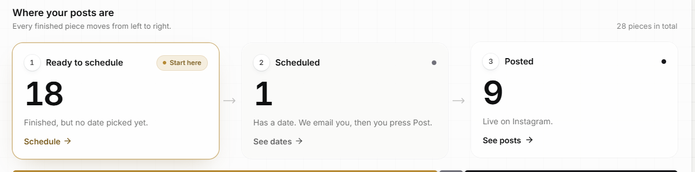
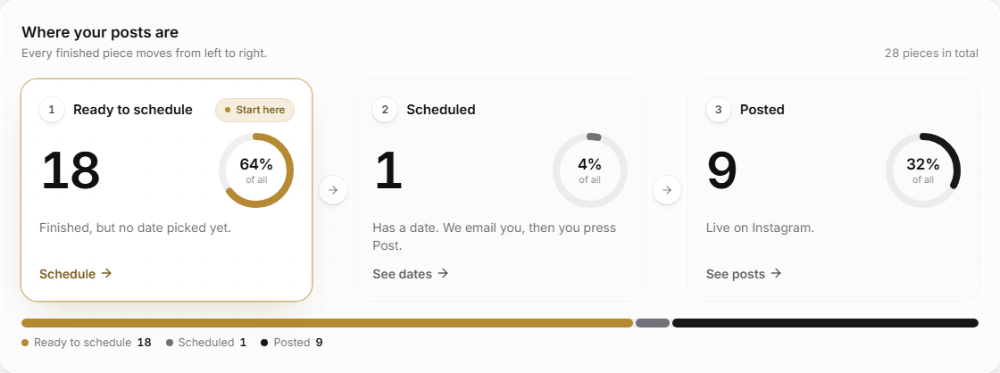
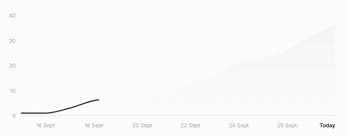
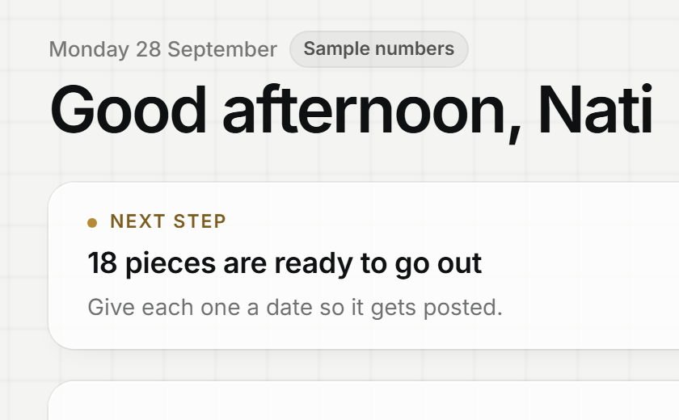

# 2026-09-28 · Dashboard redesign

**Scope:** the Dashboard (Overview) page and the sidebar, from the screenshots of the live app.
**Backend:** untouched. Same four API calls, same data, same fields.

## Before and after

| Before | After |
|---|---|
|  |  |

More views: [phone](assets/2026-09-28/after-phone.png) · [empty account](assets/2026-09-28/after-empty-states.png) · [Instagram with posts](assets/2026-09-28/after-instagram-with-posts.png) · [old sidebar](assets/2026-09-28/before-sidebar.png)

## What was wrong

- Icons were 12px at 25% opacity (`w-3 h-3 text-fg/25`), so they almost disappeared.
- Key numbers were 13px. JetBrains Mono was only loaded at weights 400 and 500, so every "bold" number was faked by the browser and looked smudgy.
- The activity "graph" was a 40px line with no axis, no days and no values.
- Quick-action icons were watermarks at 5% opacity.
- The type chips on Recent work were see-through and unreadable on busy posters.
- The "Scheduled" tooltip said the system posts automatically. It does not: the backend only emails a reminder, and a person presses Post.
- In the sidebar, "SMAA intelligence" wrapped onto two lines because of the beta badge.

## What changed

### Dashboard (`frontend/src/pages/Dashboard.tsx`)

1. **Header.** "Good afternoon, Mayada", today's date, and one sentence about what needs attention (for example "18 finished pieces are waiting to be scheduled."). Buttons: Library and New content.
2. **Content pipeline panel (the signature piece).** A black panel in 42's own black with a faint grid. It shows the real flow: Not scheduled → Scheduled → Posted.
   - Big numbers.
   - The stage waiting on you glows teal with a "Waiting on you" tag.
   - Each stage is clickable: Library, the schedule, or Instagram.
   - A bar underneath shows where everything sits, including cancelled posts.
3. **Totals strip.** Videos, Images, Editor projects, Assets and AI spend. Each has a coloured 18px icon, a 28px number, and a one-line explanation.
4. **Production.**
   - A colour-coded bar shows each tool's share.
   - One row per tool gives the count, percentage, and done / running / failed.
   - Chips at the bottom give the totals.
   - Tool colours match the Library.
5. **Activity.** A real 14-day bar chart:
   - Scale lines at 0, the midpoint, and the top.
   - Day numbers along the bottom, with "Today" marked.
   - The busiest day is highlighted and labelled.
   - Hovering or tabbing to a bar shows the date and count.
   - Summary boxes: created, daily average, busiest day.
6. **Instagram.**
   - One panel: posts, likes and comments on the left, the engagement chart on the right.
   - Shows a loading state while the slow Instagram call runs (11 to 17 seconds on live).
   - Shows a clear message if Instagram can't be reached.
   - Shows a helpful empty state ("Nothing published yet") with a link to the schedule.
7. **Recent work.** Solid white type chips with a coloured dot, readable on any image. Images zoom in slightly on hover. Videos also play on keyboard focus, not only on mouse hover. The warning and placeholder symbols are now proper Lucide icons.
8. **Start something new.** Six action cards in a 3 × 2 grid, each with a coloured icon, a title, a short description and an arrow.
9. **Loading skeleton.** Matches the new layout, so nothing jumps when data arrives.

### Sidebar (`Sidebar.tsx`, `auth/AccountFooter.tsx`, `styles.css`)

- Bigger 42 logo lockup.
- The active page is a black pill with a teal icon, the same black as the pipeline panel.
- Rows are 40px tall with 18px icons and darker text.
- The "Beta" tag is smaller and never pushes a label onto two lines.
- The account card has a black avatar, name, email, and a sign-out icon button (labelled for screen readers).

### Global

- `frontend/index.html`: JetBrains Mono now also loads weights 600 and 700.
- `frontend/styles.css`: new `.dash-grid` texture class and new `.nav-item` styles.

## Kept on purpose

- The house design system (Inter, JetBrains Mono, teal `#06B6A2`, light theme, `.card`, `.btn`).
- All data logic, including the Instagram call that is deliberately fired last and not waited on, and the video tile rule that never uses `thumbnail_url` as a video poster.
- House rule: no em dashes in interface text.

## How it was checked

- `npm run typecheck`: passes.
- `npm run build`: passes.
- Screenshots in a real browser (Playwright), with test data copied from the live numbers:
  - Desktop 1440px: no sideways scroll.
  - Phone 390px: stacks to one column, no sideways scroll.
  - With Instagram posts: engagement chart draws views, likes and comments.
- Against the real local backend with an empty database:
  - Every section shows its empty state.
  - No JavaScript errors.
  - Library and Assets returned 500 because that database is empty; the page still renders.

---

## Round 2 (same day): Apple-style glass, a better chart, simpler words

**Feedback from Nati:**
- The big black panel grabbed all the attention and didn't feel good. Use Apple-style glass instead of black.
- The graph still wasn't good enough. It should look like a proper analysis chart.
- Make it simple enough for anyone to understand.

| Round 1 (black) | Round 2 (glass) |
|---|---|
|  |  |

More views: [phone](assets/2026-09-28/v2-glass-phone.png) · [chart on hover](assets/2026-09-28/v2-chart-hover.png) · [empty account](assets/2026-09-28/v2-glass-empty-states.png)

### Glass instead of black

- **New shared styles** in `styles.css`:
  - `.glass`: translucent white, a 22px blur with extra colour saturation, a bright top edge and a hairline outline.
  - `.glass-hover`: lifts 2px on hover.
  - `.glass-inset`: a lighter pane for things that sit inside a glass panel.
- **Soft colour glow** (teal, sky, lilac, pink) behind the top of the Dashboard. Glass needs colour behind it to look like glass. The glow fades out before the lower sections.
- **No black left on the Dashboard** apart from the "New content" button.
  - The pipeline is now a glass panel.
  - The sidebar's active page is a white raised pill with a teal icon.
  - The avatar is a teal-to-sky gradient.

### The chart ("How much you made")

- **Smooth area chart** in the style of Apple Health and Stocks. It uses a monotone curve, so it never dips below zero or swings above the real peak.
- **Drawn at the real pixel width.** Text and dots stay sharp and never stretch.
- **Scale and reference lines:**
  - Lines at 0, the midpoint and the top.
  - A dashed "Average 0.7 a day" line.
  - Dates every other day, and "Today".
- **Interaction:**
  - A crosshair and a frosted tooltip ("Monday 21 September · 4 pieces made") follow the mouse or finger.
  - Left and right arrow keys move between days.
  - The tooltip flips below the point when it would cover it.
- **Trend in plain words:** a chip reads "57% less than last week", "Up from nothing last week" or "Same as last week" (green when up, rose when down).
- **Three big numbers:** "in 2 weeks", "this week" and "best day, Mon 21 Sept".
- **Layout:** the chart is now the wide panel (8 of 12 columns). "What you've made" sits beside it.

### Simpler for everyone

- **New "Next step" card** at the top: one sentence and one button, for example "18 pieces are ready to go out · Schedule them".
- **Pipeline labels** in everyday words:
  - "Ready to schedule": finished, but no date picked yet.
  - "Scheduled": has a date. We email you, then you press Post.
  - "Posted": live on Instagram.
  - A "Start here" tag marks the stage that needs you.
- **Renamed labels:**

  | Before | After |
  |---|---|
  | Editor projects | Edited videos |
  | AI spend | Spent on AI |
  | Production | What you've made |
  | Activity | How much you made |
  | Engagement | How people reacted |
  | Human Element Video (quick action) | Presenter video |
  | Video Editor (quick action) | Edit a video |

- **Status line in plain words:** "17 ready · 1 still being made · 1 didn't work". The percentages and the extra share bar are gone.
- **Every quick action** says what it does, for example "Presenter video: a person talks about your topic".

### Checked

- `npm run typecheck` and `npm run build` both pass.
- Screenshots at desktop 1440px and phone 390px. Neither scrolls sideways.
  - The first phone run did scroll sideways, because the chart started 640px wide before measuring itself. Fixed with `min-w-0` on the panels and a full-width chart wrapper.
- The hover tooltip was checked in a real browser.
- The real local backend (empty database) gave no page errors.

---

## Round 3 (same day): real glass, a square-grid canvas, premium icons, a chart you can actually see

**Feedback from Nati:**
- The glass wasn't glassy.
- Add a soft square texture to the background.
- The graph still needs work, and needs to be visible.
- The icons look like a vibe-coded app. It should feel like a $25k design.

| Per day | Running total |
|---|---|
|  |  |

More views: [full page](assets/2026-09-28/v3-full-page.png) · [phone](assets/2026-09-28/v3-phone.png)

### Why the glass didn't look like glass

Glass only reads as glass when there is colour and texture behind it to blur. The page was almost all white, so the panels looked like white cards.

### What changed

**The canvas** (`styles.css`, `body.studio-canvas`)
- A cool mist base with six large, soft colour fields (teal, sky, lilac, blue, rose, butter).
- A fine 32px square grid on top that fades toward the bottom.
- Both are fixed to the screen, so the glass keeps showing colour as you scroll.
- The Dashboard switches it on while it's open. Pages that haven't been redesigned keep their white background.
- Technical note: `<html>` paints white, so the body is set to transparent. Otherwise the body's own background would hide the canvas.

**Real glass** (`.glass`)
- A thinner fill (40 to 66% white).
- A 30px blur with 190% colour saturation.
- A lit 1px rim, bright at the top-left where the light hits and fading away. It's drawn with a masked gradient border.
- An inner top highlight, an outer hairline, and two soft shadows.

**New shared pieces**
- `.icon-well`: a small piece of glass holding one thin (1.5 stroke) ink-coloured icon.
- `.segmented`: an Apple-style switch.

**The sidebar is glass too:** translucent white, blurred, so the canvas colour shows through.

**Icons**
- The pastel icon squares and gradient tiles (sparkles, Instagram) are gone.
- Icons are thin and ink-coloured, in glass wells. Colour is only used for data: chart lines, status dots, tool colours.
- Totals tiles now show the label, a small quiet icon in the corner, and a big number.
- The pipeline steps are a real sequence, so they show 1, 2, 3, plus a status dot that matches the bar and its new legend.
- The Next Step card uses a gently pulsing teal dot instead of an icon tile.

**The chart**
- A "Per day / Running total" switch.
- 260px tall, with a soft glow under the line, dotted scale lines and a labelled average.
- The best day is marked "Best: 6". In running-total mode, the last point is marked "36 so far".
- Hovering shows a frosted tooltip.
- Big numbers sit above it without boxes, separated by thin dividers, with the week-on-week chip beside them.

**Sample-data preview (local only)**
- Open `http://127.0.0.1:4242/?demo#dashboard` to see the page with realistic sample numbers while the local database is empty. A "Sample numbers" tag appears next to the date.
- It only works on the dev server (`import.meta.env.DEV`), so it can never appear on the live site.
- Recent work still comes from the real API.

### Checked

- `npm run typecheck` and `npm run build` pass.
- Screenshots at 1440px and 390px. Neither scrolls sideways.
  - The first phone run did scroll sideways because of the new stats row. It now becomes three columns on phones.
- Both chart modes and the hover tooltip were checked in a real browser.
- The real backend page and the demo page both run with no page errors.
- Markup fix: the stats row briefly used a `<dl>` with the values before the labels and separators inside, which is invalid. It now uses plain elements.

---

## Round 4 (same day): professional, for a government office

**Feedback from Nati:**
- No gradient in the background.
- Nati doesn't like the green and blue.
- This is for a government office, not a kids' shop, so it has to look professional.

More views: [chart](assets/2026-09-28/v4-chart.png) · [lower sections](assets/2026-09-28/v4-lower.png) · [phone](assets/2026-09-28/v4-phone.png)

### Direction

- **Palette:** ink black, graphite greys and white.
- **One accent: institutional gold `#B68A35`.** It's the accent of the UAE Government Design System, and it's used only where something needs the reader's attention.
- **Other colour:** none, apart from red for "didn't work", which has to stay recognisable.

### What changed

**Background:** one flat neutral (`#F4F4F2`) with the fine 32px square grid, evenly across the screen. There are no colour fields and no gradients.

**Glass:** calmer and more solid.
- A 74% white fill with a light 10px blur, so the grid is only faintly visible.
- A subtle top highlight.
- Smaller 16px corners and lighter shadows.

**New colour token** in `tailwind.config.ts`:
- `gold`: `#B68A35`, for marks and fills.
- `gold-ink`: `#7A5C1E`, for text (about 5:1 contrast on white).
- `gold-soft`: `#F5EEDF`, for tinted backgrounds.

**Where colour went**

| Place | Before | After |
|---|---|---|
| Pipeline and its bar | Teal / sky / green | Gold for "Ready to schedule" (it needs you), graphite for Scheduled, ink for Posted |
| "Start here" tag and card outline | Teal | Gold |
| Next step | Teal button, pulsing teal dot | Ink button, small static gold dot, small uppercase "NEXT STEP" label |
| "What you've made" bars | One colour per tool | All ink; gold for "still being made", red for "didn't work" |
| Recent work chips | Coloured dots | Words only |
| Main chart | Teal-to-blue line with a glow | One ink line, a very light grey fill, and a gold marker for the best day and on hover. No glow. |
| Instagram chart | Teal / red / indigo | Views ink, likes gold, comments grey. The fill is lighter too. |
| Trend chip | Green or rose | Neutral; the arrow and the words carry the meaning |
| Sidebar | Teal active icon and teal "Beta" tag | Ink active icon, grey "Beta" tag |
| Focus rings | Teal | Neutral ink |

### Checked

- `npm run typecheck` and `npm run build` pass.
- Screenshots at desktop and phone width. Neither scrolls sideways.
- The real backend page runs with no page errors.
- **Dev-server gotcha:** after adding a new colour to `tailwind.config.ts`, the running dev server kept using the old config. The gold showed up as default blue rings until the server was restarted. **Restart `npm run dev` whenever `tailwind.config.ts` changes.**

---

## Round 5 (same day): round gauges in "Where your posts are"

**Feedback from Nati:** the three step cards looked flat and needed something round. Everything else stays as it is.

| Before | After |
|---|---|
|  |  |

[Phone view](assets/2026-09-28/v5-rings-phone.png)

### What changed (`Dashboard.tsx` only)

- **New `ShareRing` component:** an 84px round gauge next to each step's big number.
  - It shows that step's share of all pieces ("64% of all").
  - Each step uses its own colour, the same as its slice of the bar below: gold for Ready to schedule, graphite for Scheduled, ink for Posted.
  - The ring sweeps in from zero when the page opens (1.1s, easing out). With reduced motion switched on it appears instantly, through the global rule in `styles.css`.
  - Screen readers hear "Ready to schedule: 64% of all pieces".
  - A 0% ring shows only the grey track, not a stray dot.
- **Round connectors:** the arrows between the steps are now small round white buttons instead of thin lines.
- **Header cleanup:** the small colour dot at the top right of each card is gone, because the ring now carries the colour.

### Checked

- `npm run typecheck` and `npm run build` pass.
- Desktop and phone screenshots: no page errors, no sideways scroll.

---

## Round 6 (same day): quiet motion

**Feedback from Nati:** happy with the design. Add some cool things (instead of Framer for now).

Three restrained touches that suit a professional tool. All of them switch off for people who use "reduce motion".

1. **Numbers count up** on load, over 0.9s with an ease-out: the pipeline numbers, the five totals (including the money) and the "What you've made" total. A new `CountUp` component in `Dashboard.tsx` does this. Screen readers only hear the final value.
2. **The chart line draws itself** left to right in 1.4s, and the grey fill fades in behind it. It redraws when you switch between Per day and Running total. The "Best" / "so far" marker fades in when the line reaches it, and does not replay after hovering.
3. **Sections rise in one after another:** Next step, pipeline, totals, charts, Instagram, spaced 60 to 70ms apart. This uses the new `Reveal` wrapper and the `animate-reveal` class.

New animations in `tailwind.config.ts`: `drawLine` and `reveal`.

### Bugs found and fixed while checking

- **Numbers didn't count up in development.** React runs each effect twice in development. My cleanup jumped the counter to its final value, so the second run had nothing to animate. The counter now remembers where it really is and continues from there.
- **One negative frame** ("-0", "$-0.07"). A browser frame's timestamp can be slightly earlier than the moment the timer starts. The counter now times from the first frame and never goes below zero.

### Checked

- `npm run typecheck` and `npm run build` pass. The dev server was restarted after the `tailwind.config.ts` change.
- A frame-by-frame trace in a real browser: the totals go 0 → 1 → 2 … → 11, 87 and $8.37, finishing at about 0.98s with no negative values.
- With reduced motion switched on, the final values show immediately.
- No page errors. No sideways scroll on desktop or phone.

---

## Round 7 (same day): softer background grid

**Feedback from Nati:** add a very, very small blur to the background squares, so the page feels more focused.

- `styles.css`, `body.studio-canvas::after`: `filter: blur(0.7px)`. The grid lines are slightly out of focus, like a background, and the content in front stays sharp. It's kept under 1px so the squares still read as squares.
- Checked: build passes, the computed style shows `blur(0.7px)`, and there are no page errors.

---

## Assets page redesign (same day)

**Feedback from Nati:** redesign Saved assets in the same style as the Dashboard. Keep it simple for non-technical staff, and keep every function the backend developers built.

The full before/after, the changed words and the questions for the team are in [Design_by_nhatty.md](Design_by_nhatty.md).

**What changed:**
- `pages/Assets.tsx`:
  - An overview with picture previews per group and a summary line.
  - A group view with a clear header, a search box with a clear button, and friendly empty and no-results states.
  - A three-step upload window.
  - New tiles for music and video.
- `components/assets/AssetDetail.tsx`: the same features with a new look, plain words and icons on the buttons.
- New `lib/useStudioCanvas.ts`: the grid background as one shared hook, now used by both the Dashboard and Assets.

**Not changed:** every API call, the category and total keys, the upload logic, and the edit, pause and delete logic.

**Checked:**
- Type check and build pass.
- Browser screenshots of the overview, a group, no search results, music, upload, the asset window and phone width. No errors and no sideways scroll.
- Against the real (empty) local server, the page shows the calm error card.

---

## Brand page: Profile tab (same day)

**Feedback from Nati:** the Brand page text is messy. Make it look nice.

The full before/after is in [Design_by_nhatty.md](Design_by_nhatty.md).

**What changed:**
- `pages/Brand.tsx`: the Profile is now a small brand book.
  - A summary card with "Built from…".
  - "Jump to" buttons.
  - One card section per part: How we sound, Brand colours (click to copy), Typefaces, Who we talk to, What we talk about, What our visuals show, Phrases we use, Brand rules, Notes for the AI.
  - Plain-word source badges.
  - Calm loading, error and empty states. The empty state links to the Synthesizer.
- `pages/BrandWorkspace.tsx`:
  - The grid canvas.
  - A big title with a plain one-line explanation per tab.
  - A glass tab switch that is local to this page; the shared `TabBar` is untouched.

**Not changed:** `GET /api/brand` and every field it returns. All of them are still shown. The Upload, Synthesizer and Instagram tab contents are unchanged.

**Checked:**
- Type check and build pass.
- Screenshots on desktop and phone: no errors and no sideways scroll.
- Clipboard copy verified.
- All four tabs open.
- Error card against the real (empty) server.

---

## Ideation (same day, waiting for Nati's review)

**Feedback from Nati:** make Ideation amazing. Nati will review it and send feedback.

The full before/after is in [Design_by_nhatty.md](Design_by_nhatty.md).

**What changed:**
- **The hub:** "What do you want to make?" with a line drawing per tool (new `ToolIllustration.tsx`), output tags, a General video chooser, and the Video Editor under "Already have footage?".
- **The roadmap bar:** a glass stepper with a plain hint per step, gold for "you are here", a black check for done, and a rounded Copy link.
- **All 7 tools and the Caption, Schedule and Approve steps:** wrapped in the new `.studio-ui` layer. Readable labels, ink accent, quiet cards and rounded buttons and inputs, with no creator code changed. The Video Editor is excluded because of its dark screens.
- **The accent is now a CSS variable** (`--accent-rgb`). Teal stays everywhere else, verified at `rgb(6, 182, 162)` on Settings and Library.
- **`useStudioCanvas`** now keeps a count, because Ideation stays mounted when hidden. Verified: on for Ideation and Dashboard, off for Library and Settings.

**Checked:**
- Type check and build pass. Dev server restarted.
- All 7 tools open with no page errors.
- Phone: no sideways scroll.

**Open for next round:**
- Human Element Video Studio's full-width panel and its old inner step chips.
- The Video Editor's own look.
- Technical cost/model lines in plain words?

## Notes for next time

- The mobile top bar still shows "42" as text instead of the real logo (`components/Layout.tsx`). It's a small follow-up.
- The Library, Ideation and the other tabs still use the old look. They are good candidates to bring up to this standard next.
