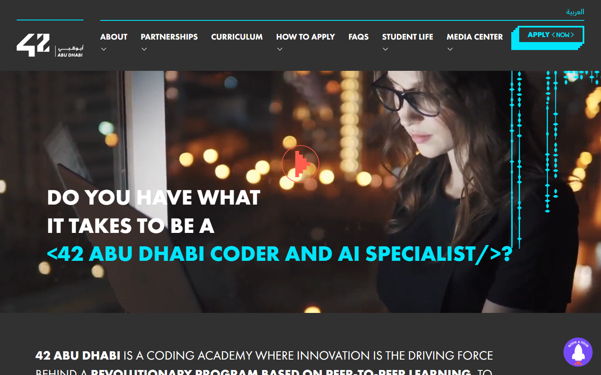
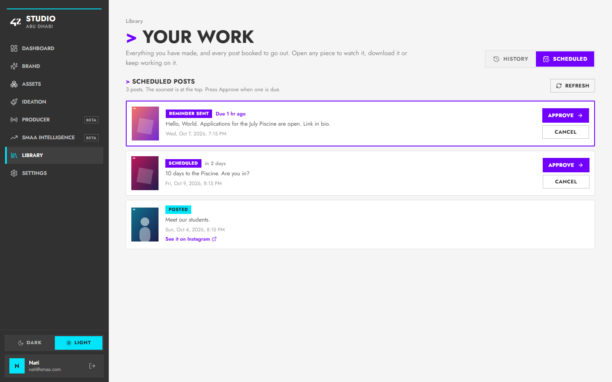
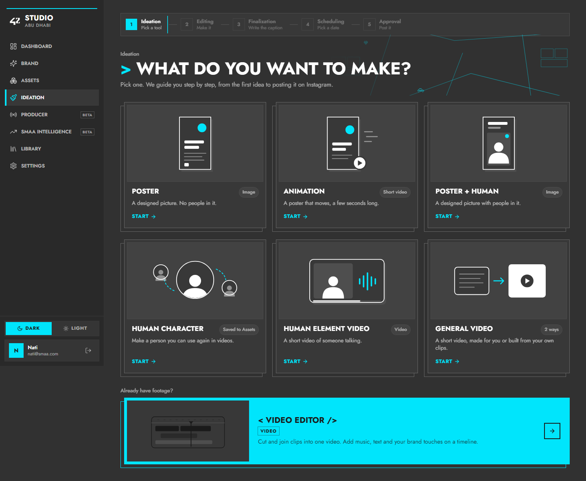
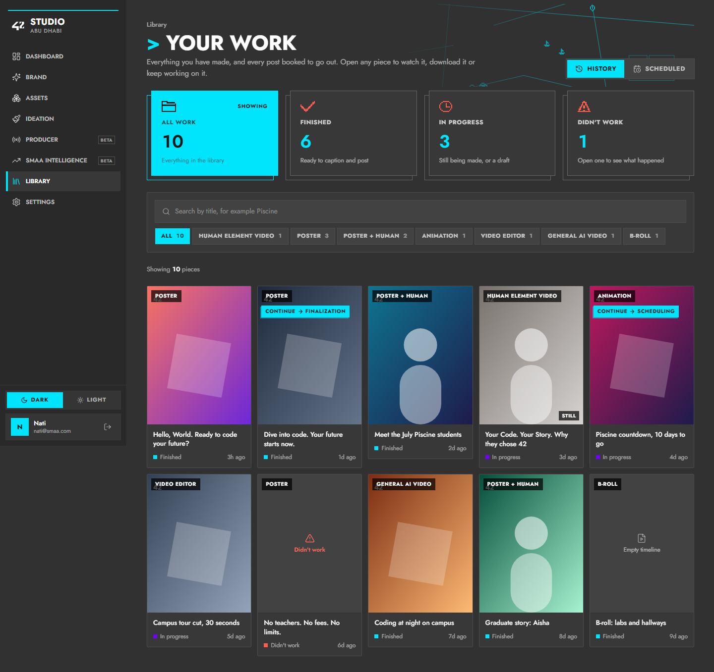
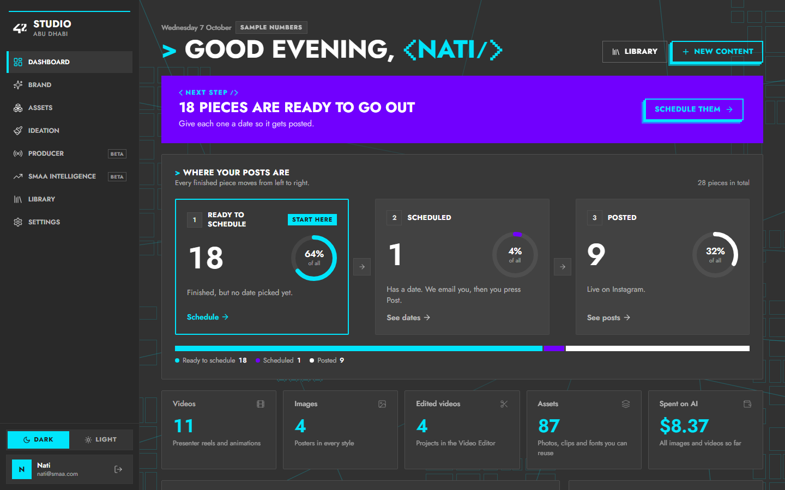
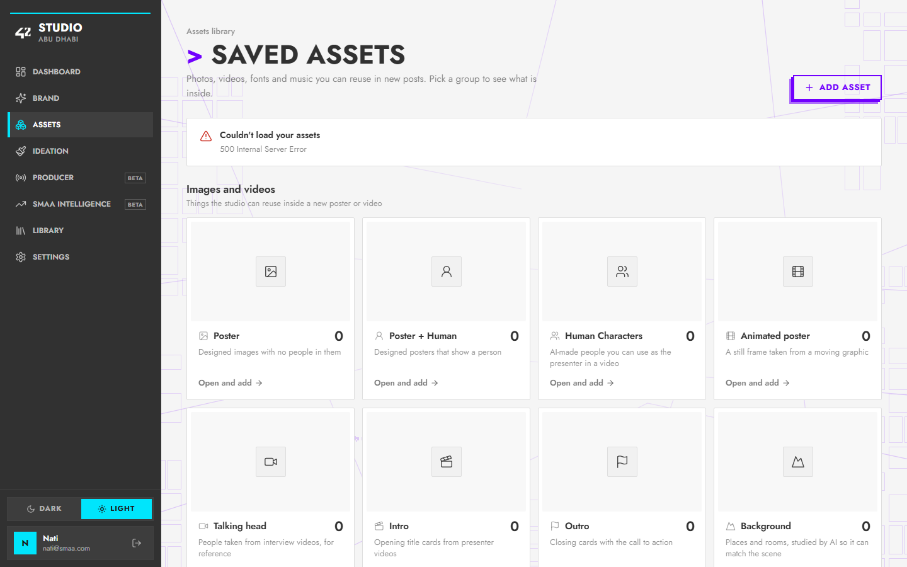

# Wednesday 7 October 2026 · 42 Abu Dhabi branding

**Feedback from Nati and the team:**
- The team doesn't like the square-grid background.
- Replace the gold with 42's own brand colours.
- Use the official 42 branding from **42abudhabi.ae**.
- Finish the rest of the screens.
- Frontend only.

## 1. What 42abudhabi.ae looks like (studied in a real browser)

| | 42abudhabi.ae |
|---|---|
| Background | Charcoal **#313131**, with **#4A4A4A** for panels. Not pure black. |
| Signature colour | Electric cyan **#00E5FC**, for lines, highlights and the "APPLY <NOW>" button |
| Second colour | Electric purple **#7100FE**, for big blocks and the curriculum circles |
| Text | White on charcoal |
| Type | **Futura PT**: bold UPPERCASE headings and Futura body text. VG5000 (a pixel font) for small details. IBM Plex Sans Arabic for Arabic. |
| Motifs | Code brackets in headlines (`<42 ABU DHABI CODER/>`, `ZERO < TUITION />`), a "> " lead-in, a button with a stepped cyan offset shadow, thin cyan rule lines |

**Key finding:** the 42 cyan only works on dark backgrounds. On white its contrast is 1.4:1, while readable text needs 4.5:1. That's why the website is charcoal everywhere.

## 2. Nati asked to see both options first

The Dashboard and sidebar were built so **one theme switch** changes everything:

| 42 Dark (like the website) | 42 Light (charcoal frame) |
|---|---|
|  |  |

Full pages: [42 Dark](assets/2026-10-07/42-dark-dashboard.png) · [42 Light](assets/2026-10-07/42-light-dashboard.png) · Phones: [Dark](assets/2026-10-07/42-dark-phone.png) · [Light](assets/2026-10-07/42-light-phone.png)

**What is the same in both:**
- **Background:** plain. The grid and every gradient are gone.
- **Sidebar:** 42's charcoal rail with the white 42 logo, "STUDIO / ABU DHABI", a thin cyan line on top, and a cyan bar and icon for the current page. The phone menu and phone top bar match, and the phone bar now shows the real 42 logo.
- **Headline in 42 style:** "> GOOD EVENING, <NATI/>", with the name as a cyan code bracket.
- **Type:** headings and big numbers use **Jost**, a free Google font made after Futura. 42's Futura PT is a paid font.
- **The 42 button:** every main button is the cyan block with the stepped offset shadow from the website, and it presses into its shadow when clicked.
- **Gold is gone.** Cyan marks "needs you" and actions, purple marks "scheduled", and the chart uses cyan in Dark and purple in Light.

**Differences:**
- **42 Dark:** charcoal **#313131** everywhere, white text, cyan text accents. It looks exactly like the website.
- **42 Light:** light grey content with white cards inside the charcoal frame. Cyan is only used as a fill (never as text), and purple carries accent text, because cyan text on white is unreadable.

## 3. How it was built (so the rest of the screens are fast)

- **New colour tokens** `k-*` in `tailwind.config.ts`: canvas, surface, inset, line, text, cyan, accent, purple, chart, danger and rail. Each is a CSS variable set per theme in `styles.css`.
- **New `lib/theme.ts`:** picks the theme with `?theme=dark` or `?theme=light` in the address bar, remembers it, and defaults to dark. It's applied before the first paint.
- **New pieces:**
  - `.k-panel`, `.k-inset`, `.k-well`, `.k-hover`, `.k-seg`
  - `.k-btn` (the 42 offset button) and `.k-btn-ghost`
  - `.k-display`, `.k-title`, `.k-num` (Jost type), `.k-code` (the cyan bracket word)
- **Hooks:** `useKCanvas()` for the 42 background. `useStudioCanvas()` is still there, and both share one counter (`useBodyClass`).
- **Not changed:** the backend, and every API call. Assets, Brand and Ideation keep last week's light look, minus the grid, until Nati picks a theme.

**Checked:**
- Type check and build pass.
- Both themes on desktop and phone: no page errors and no sideways scrolling.
- Fixed after the first look: in Dark, the chart's "Average" tag was a white box and the "What you've made" bars were charcoal on charcoal. Both now use theme colours.

## Problems met today

- **GitHub said "Repository not found"** for `agegnew/42-studio`. The repository was probably renamed, made private, or access changed. Nothing was pushed. We need the right address before the next push.
- **The local helper tools had been partly deleted** by Windows' temp-folder clean-up. They were rebuilt. The test database also needed a slow recovery, and it now runs on a different port.

---

## Round 2 (same day): real 42 look, both themes, every page

**Feedback from Nati:**
- Why only one page?
- The Dark version doesn't look like 42 Abu Dhabi.
- Keep both Light and Dark.
- Do all the pages.
- Study the website more. There's a meeting tomorrow.

**Why only one page:** after "Show me both first", I built only the Dashboard so Nati could choose before everything was converted. Now every page is done.

**Why it didn't look like 42:** it used Apple-style rounded, soft cards. The website measures as square (441 of 444 elements at 0px radius), with outlined cyan buttons, purple blocks, Futura capitals and `> TITLE` headings.

**Studied more of 42abudhabi.ae:** About, How to apply, FAQs, Piscine status, Application journey, News, Partnerships and the footer. New findings: coral **#FF5E4E**, the pixel font for brackets, square boxes with cyan outlines, the 3-step solid button shadow, and light sections on the About page. See [MEETING_2026-10-08_42_BRANDING.md](MEETING_2026-10-08_42_BRANDING.md).

**What changed:**
- **`styles.css` rebuilt as one 42 design system:**
  - Square cards, inputs and buttons.
  - The outlined 42 button (`.btn-primary` / `.k-btn`).
  - The purple feature block (`.k-feature`).
  - Futura-style labels and titles, with the "> " lead-in on section titles.
  - The theme ground with no grid.
- **The app-wide tokens now read the theme** (`bg`, `fg`, `muted`, `border`, `accent`, `gold`), so **every page** follows 42 Dark / 42 Light, including pages that were never redesigned.
- **Square corners app-wide** (the radius scale), with avatars and dots still round.
- **App font is Jost** (Futura-style). **Pixelify Sans** for the `<` `/>` brackets.
- **Dark/Light switch** above the account card, remembered per browser. Also in the phone menu.
- **Dashboard:**
  - "Next step" is now the purple 42 block.
  - Cyan numbers.
  - Square stage boxes, with a cyan frame for "Start here".
  - Pixel brackets in "<NATI/>".
- **Brand, Assets, Ideation:** 42 page titles with "> ", a square Brand tab switch, and the tool drawings in theme colours.
- **Sidebar** widened to 256px so "SMAA INTELLIGENCE" fits.

**Checked:**
- Type check and build pass.
- **26 screens** (13 pages × 2 themes): no errors, no sideways scroll, no white panels in Dark.
- Every sidebar and step label fits.

| 42 Dark | 42 Light |
|---|---|
|  |  |

---

## Round 3 (same day): the Library page

**Feedback from Nati:** build the Library page in the 42 branding.

| 42 Dark | 42 Light (Scheduled tab) |
|---|---|
|  |  |

More: [Light history](assets/2026-10-07/library-light.png) · [Dark scheduled](assets/2026-10-07/library-sched-dark.png) · [detail window](assets/2026-10-07/library-detail.png) · [no search results](assets/2026-10-07/library-nomatch.png) · [phone](assets/2026-10-07/library-phone.png) · [empty server](assets/2026-10-07/library-real.png)

**What changed** (`components/yas/YasLibrary.tsx` and `components/yas/roadmap/ScheduledQueue.tsx`):
- **A page title,** "> YOUR WORK", with one plain sentence. Before, the Library had no title at all.
- **History / Scheduled** as a square switch beside the title.
- **Four summary tiles** in big cyan numbers: All work, Finished, In progress and Didn't work. The first three **are the status filter** (the same filter as the old status chips), and the active one says "Showing".
- **A search box** for titles. It filters the list already in the browser and makes no new backend call. **This is the only new feature.**
- **Type filter** as square uppercase chips. The rainbow colour dots are gone; the 42 colours now only mean status (cyan finished, purple in progress, coral didn't work).
- **Work tiles:**
  - Square, with a readable type label on a dark plate.
  - A status line with the date.
  - The cyan **"CONTINUE → STEP"** button sits under the label, so it no longer covers it.
  - Copy-link appears on hover.
  - Real icons instead of the ⏳ ⚠ ▤ emoji.
  - "Still" / "Scene" tags moved to the bottom corner.
- **Detail window:** square 42 panel, plain status words ("Saved to assets", not `saved_to_assets`), an X close icon, and 42 buttons.
- **Scheduled tab:**
  - A "> SCHEDULED POSTS" title with one line of guidance.
  - Status in the 42 colours: purple Scheduled / Reminder sent, cyan Posted, coral Didn't post.
  - A post that is due gets a cyan frame.
  - Buttons say "Approve →", "Try again" and "Cancel".
  - Posted items link to "See it on Instagram".
  - A proper empty state with a "Make something" button.
- **Empty, error and no-results states** are 42 panels with a clear next step.

**Not changed:** every API call and every action: open, continue, copy link, download, remove logo, delete, export to the editor, approve and cancel. Infinite scroll still works and now counts the searched list.

**Checked:**
- Type check and build pass.
- Dark and Light, History and Scheduled: no errors and no sideways scroll. The phone has no sideways scroll either.
- The "Finished" tile filters correctly.
- Searching "piscine" shows exactly the 2 Piscine pieces.
- The detail window opens and closes with Escape.
- The real (empty) server gives no page errors.
- Fixed while checking: the Continue button covered the type label; "Still" bumped into a long label; and the step name was cut off.

## Round 4 (same day): the 42 website's own components

Nati sent three screenshots of 42abudhabi.ae and asked for those components in the studio. The ask was something big, not small changes. So the studio now has a reusable **42 component kit** (`frontend/src/components/k42/`), and the main pages use it.

| Website component | Built as | Where it is used |
|---|---|---|
| Stacked square cards with a frame peeking out behind ("ZERO < TUITION />") | `StackCard` | Dashboard "Make something new", the Ideation tool cards, the Library summary tiles |
| The one cyan card ("LEVEL 6 QUALIFICATION") | `StackCard tone="cyan"` | Ideation "Video Editor" card; the Library filter you are looking at |
| Coral pixel-art icons (banknote, cap, pencil ...) | `PixelIcon`, 19 icons drawn pixel by pixel | Dashboard cards, Next step, stats block, Library tiles |
| ZERO < TUITION /> headings | `BracketTitle` | PRESENTER < VIDEO />, < POSTER />, BRAND < BOOK />, < VIDEO EDITOR /> |
| "Dec0de your < ambit_ >" pixel headline with a coral cursor | `PixelHeadline` | Dashboard: "> GOOD EVENING, < Nati_ >" |
| Cyan line-art map (streets, pin, boats, hearts, cars) | `CircuitMap`, with a light pulse travelling along the main street | Headers of Dashboard, Ideation, Library, Assets and Brand; behind the Dashboard cards |
| Dotted circuit lines with diamond beads | `BeadLine` | Beside the stats block; between the step cards |
| Purple "> THE 42 NETWORK" block with big cyan numbers | `StatBlock` | Dashboard: "> THE STUDIO IN NUMBERS" (videos, images, edited videos, assets, spent on AI) |
| Purple STEP 1 / 2 / 3 cards joined by circuit lines | `StepTrail` | Dashboard "Where your posts are". The step to act on has the cyan stepped edge and "START HERE". The round % rings stay. |
| Thin cyan outlined box | `OutlineBox` (`k-outline`) | Dashboard "Next step" |

**How it moves (Apple rules):**
- A card lifts up and to the right on hover, and drops onto its frame the moment you press it.
- The cursor blinks, the beads glow one after another and a light runs along the map.
- With "reduce motion" on, all of this stands still.

**Dashboard order is now:**
1. Greeting
2. Next step
3. Where your posts are
4. How much you made / What you've made
5. The studio in numbers
6. Instagram
7. Your latest work
8. Make something new

The two purple areas are kept apart on purpose.

**Not changed:** no backend file, API call or feature. Every card opens the same place it did before.

**Strong test:**
- Type check and production build pass.
- **All 13 screens x Dark and Light:** 0 page errors, 0 sideways scroll, 0 white panels.
- **3 sizes** (phone 390, tablet 820, desktop 1440) x 2 themes x Dashboard, Ideation and Library: 0 sideways scroll.
- **Readable contrast**, measured on every text inside the new components (WCAG 4.5:1, or 3:1 for large text). The first run found 9 faint texts: "// STEP" on purple, "of all", the stats and card descriptions, the Library hints and the Ideation tags. All were fixed, and the re-run shows **0 failures**.
- **Keyboard:** Tab reaches all 9 Dashboard cards and steps, each one shows a clear focus frame, and Enter opens the right page.
- **Clicks:** Step 1 goes to Library, and "Presenter video" goes to Ideation > Human Element Video.
- **Hover:** the card lift is measured at (3px, -3px).
- **Reduced motion:** the cursor, beads and map pulse are still.
- **Library:**
  - The filter tiles announce "pressed", and Finished and the search still filter correctly.
  - On the real (empty) server there are no page errors.
  - The local test database is missing one table, so `/library` returns 500 there. That comes from my throwaway local database, not the code; production is not affected.

| Dashboard, Dark | Dashboard, Light |
|---|---|
|  |  |

| Ideation, Dark | Library, Dark |
|---|---|
|  |  |

## Round 5 (same day): Nati's correction. Keep only the map background, softly, on every page

**Nati's feedback on Round 4:** the new cards were ugly; the page was nicer before. The only part Nati liked was the **map line background**, and Nati wants more of it, softly, on every page.

**What I did:**
- **Put back the design from before Round 4:**
  - Dashboard: the greeting, the purple Next step, the "Where your posts are" panel with the round % rings, the five total tiles, and the quick cards.
  - Ideation: the tool cards and the Video Editor card.
  - Library: the summary tiles.
  - Assets and Brand: the page titles.
- **New: one soft city map behind every page** (`components/k42/MapBackdrop.tsx`, mounted once in `Layout.tsx`):
  - It follows the 42 website: dense city blocks along the edges, long thin streets crossing, and small pixel boats, hearts, cars and a pin.
  - It is soft: very light lines (cyan in Dark, purple in Light) that fade out in the middle of the page, where people read.
  - It stays still while you scroll and fades in gently when the app opens. It never moves on its own and never takes clicks.
  - Full-screen tools (the Video Editor timeline) hide it, so the editing surface stays calm.
- The Round 4 component kit files are still in `components/k42/`, but no page uses them now.

**Not changed:** no backend file, no API call, no feature.

**Checked:**
- Type check and production build pass.
- All 13 screens x Dark and Light: 0 page errors, 0 sideways scroll, 0 white panels.
- Library: filter, search, phone and the real (empty) server are fine.
- Pop-up windows still cover the sidebar (desktop and phone), and the map never blocks a click (`pointer-events: none`).

| Ideation, Dark | Settings, Light |
|---|---|
|  |  |

| Dashboard, Dark | Assets, Light |
|---|---|
|  |  |

## Round 6 (same day): buttons fix, animations back, real data

**Nati's feedback:**
- A mistake in the header buttons (screenshot).
- Bring back the animation Nati liked.
- Animate the charts and keep them fast.
- Show the redesign with the **real data** from the live studio (api.42studio.fit) instead of empty or sample screens.

| What | Change |
|---|---|
| **Button mistake** | The 42 buttons were see-through, so the map lines ran through "LIBRARY", and the "New content" stepped shadow almost touched it. Buttons are now **solid in the colour of the surface under them** (page, panel or purple block), and the two buttons have more space between them. |
| **Animation back** | The light **running along the map lines** from Round 4 is back, on the page-wide map: 5 streets light up one after another, softly. It switches off for people who turn off animations. |
| **Charts animate when you see them** | The "How much you made" line draws itself in, the "What you've made" bars grow in one after another, and the Instagram lines draw in. Each starts **when it scrolls into view**, so the reader sees it, instead of it finishing unseen while the page opens. |
| **All 4 Round 4 animations back (Nati picked them)** | Light running on the map (a little brighter), glowing diamond beads on map lines, the coral blinking cursor after the name ("<NATI_/>"), and cards lifting up-right on hover with a thin stepped shadow, dropping back on click. The Round 4 card designs stay removed. |
| **Live point** | A soft pulsing ring marks today on the trend line. |
| **Fast** | The animations only move position and opacity (no layout work). Charts off screen do no animation work at all (paused by CSS, no extra re-renders). |
| **Real data (for the meeting)** | The dev server can now read the live studio: `API_TARGET=https://api.42studio.fit npx vite --port 4243`. Sign in on http://127.0.0.1:4243 with the normal account. Only `frontend/vite.config.ts` changed (an opt-in setting); nothing in the backend. **Careful:** in that window every button acts on the real studio. My automatic screenshots block every request that would change something (only reads are allowed). |

**Checked:**
- Type check and build pass.
- 26 screens: 0 errors and 0 sideways scroll.
- The buttons are solid in both themes.
- The 5 map lights are running.
- The chart gates open only when scrolled to.

## Next

1. Corrections from Nati after the meeting.
2. Look at Library, Producer and SMAA intelligence again with real data.
3. Review the Video Editor's own dark screens.
4. Get the new GitHub address and access, then push (only after Nati approves).
