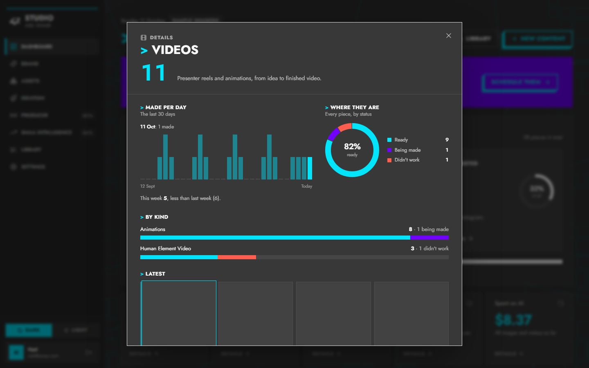
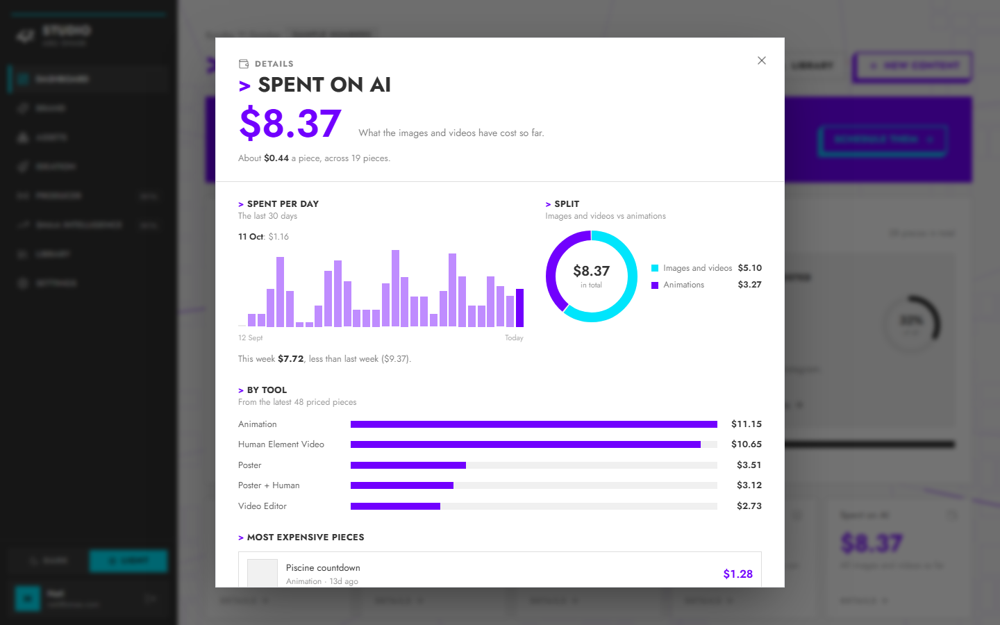

# 11 October 2026

## Dashboard totals open a detail window

**Nati asked:** make the five totals (Videos, Images, Edited videos, Assets, Spent on AI) clickable. Each should open a window with its details, small charts and smooth animation.

**What I built** (`frontend/src/components/dashboard/KpiDetail.tsx`):
- Every total tile is now a button with a "Details →" hint, and lifts on hover.
- The window **grows out of the tile you clicked** and **shrinks back into it** when it closes, so it leaves the same way it came. The page behind dims and softly blurs. The content fades in as the window lands.
- **Videos / Images / Edited videos:**
  - a "Made per day" bar chart for the last 30 days (point at a bar to read it)
  - this week vs last week
  - a ring showing Ready, Being made and Didn't work
  - a split bar per kind
  - the 4 latest pieces as pictures, which open in the Library
- **Spent on AI:**
  - spend per day
  - a ring splitting images and videos vs animations
  - cost by tool
  - the average cost per piece
  - the 3 most expensive pieces
- **Assets:**
  - a ring by kind (images, videos, people, stickers, fonts, music)
  - a bar per kind
  - how many are active vs paused
  - the latest uploads
- The bars grow in one after another, and the rings draw themselves in.
- Escape, the X button or a click outside closes the window. Focus moves into the window and returns to the tile.
- With "reduce motion" on, all of this is instant.

**Data:** only existing reads, no backend change:
- `/stats` and the asset totals the Dashboard already loads
- the Library list (`/api/yas-producer/library`), fetched once when a window first opens
- the newest assets (`/api/agents/producer/assets`)

**Checked:**
- Type check and build pass.
- All 5 windows tested in Dark and Light at desktop size, and 2 of them on a phone.
- Each window opens, lands in place and closes with Escape, and focus returns to its tile.
- No page errors and no sideways scroll.

| Videos, Dark | Spent on AI, Light |
|---|---|
|  |  |
