# 14 October 2026

## Sign-in page redesigned

**Before:** in 42 Dark, the left half of the sign-in page was white, so the white 42 logo almost disappeared. The form was plain, with no 42 look.

**Now** (`frontend/src/components/auth/SignInScreen.tsx`):
- **Brand panel** (left, charcoal in both themes, like the sidebar):
  - the animated 42 city map, with the running light and glowing dots, quieter behind the words
  - a cyan line along the top
  - the 42 Studio / Abu Dhabi lockup
  - the headline "> MAKE POSTS THAT LOOK AND SOUND LIKE <42_/>", with the blinking coral cursor
  - the 3 steps of the studio: Pick a tool → AI makes it → You press Post
- **Form** (right, follows the theme):
  - "> SIGN IN", with email and password fields that have icons
  - **Show / hide password** and a **Caps Lock is on** warning
  - the 42 stepped Sign in button, which shows a spinner while it checks
  - plain errors that shake gently: "Type your email first.", "Type your password.", or the server's own "That email and password don't match." After a wrong password, the password is selected so it is easy to retype.
  - "Forgot your password, or need an account? Ask your 42 Studio admin."
  - a **Dark / Light** switch, also on this page
- **Motion:** the brand panel and the form rise in one after another. With "reduce motion" on, everything is still.
- **Phone and tablet:** the brand panel becomes a short band above the form.
- Browser autofill keeps the field colours, instead of Chrome's pale yellow.

**Not changed:** the same sign-in call (`POST /api/auth/login`), the same fields, the same server messages. No backend change.

**Checked:**
- Type check and build pass.
- Tested in Dark and Light at desktop, tablet (820) and phone (390): no errors and no sideways scroll.
- These all work:
  - empty submit (message, and the cursor moves to the empty field)
  - wrong password
  - show password
  - the Caps Lock warning
  - the theme switch
  - a correct sign-in, which opens the app

| Dark | Light |
|---|---|
| 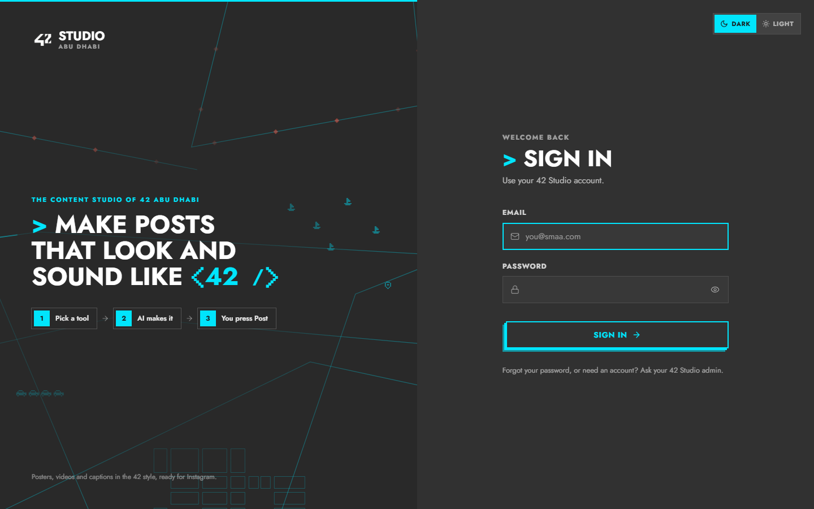 | 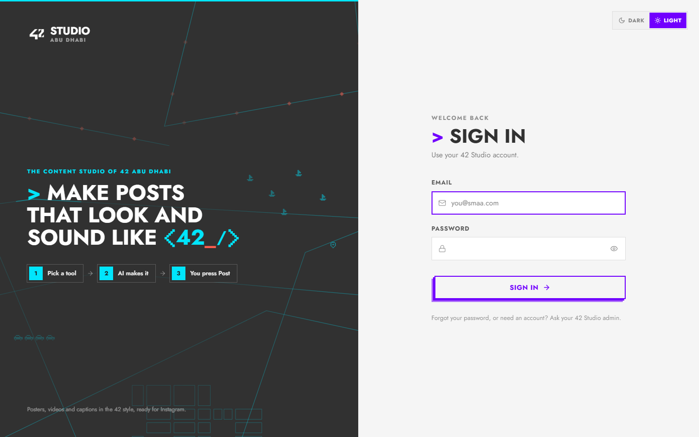 |

| Wrong password | Phone |
|---|---|
| 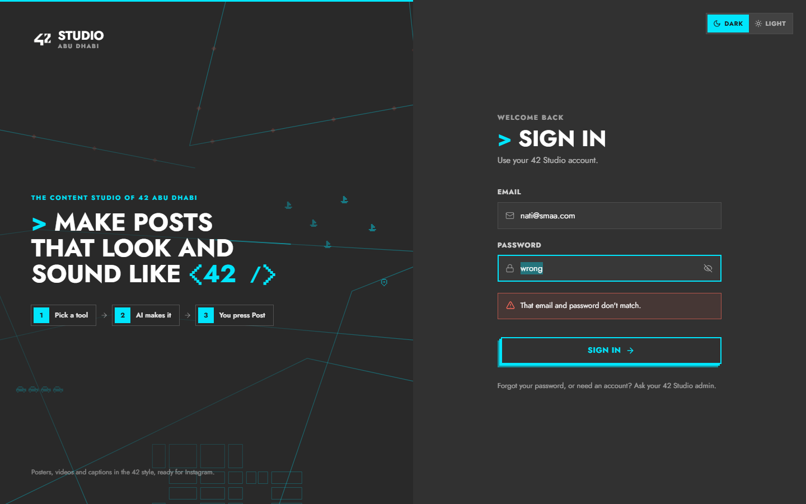 | 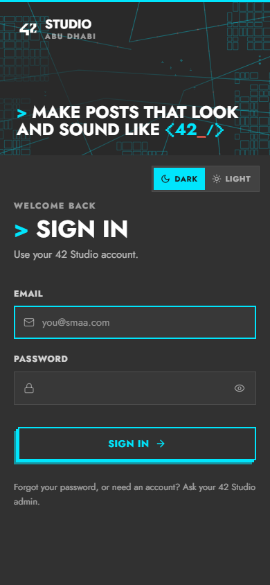 |

## Round 2 (same day): detail windows, SMAA story detail, "This week", meeting doc

**For tomorrow's meeting with the CEO and leadership:** a Claude Doc with the full update (what changed, before/after, what's new, an honest check, ideas, decisions). Link: https://claude.ai/code/artifact/008f2f0d-f9a4-4eee-86c8-e1851ffc6aa5

### 1. Dashboard detail windows now all look like the Assets one
Nati liked the Assets window, so Videos, Images, Edited videos and Spent on AI now use the same layout:
- a ring on the left (by status, or the spend split)
- coloured bars on the right (how many of each, or cost by tool), plus a thin meter ("Ready to caption and post", or the average per piece)
- the 30-day chart across the full width
- big square pictures of the latest pieces, or of the most expensive ones with the price on each

| Videos | Spent on AI (Light) |
|---|---|
| 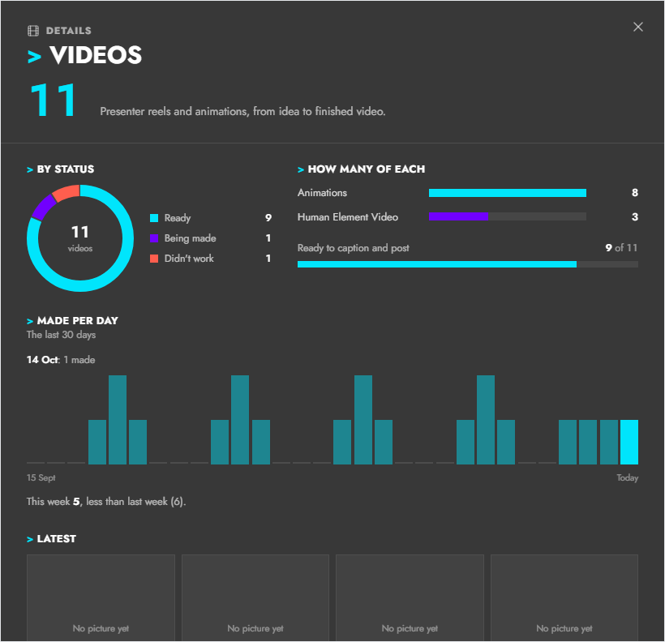 | 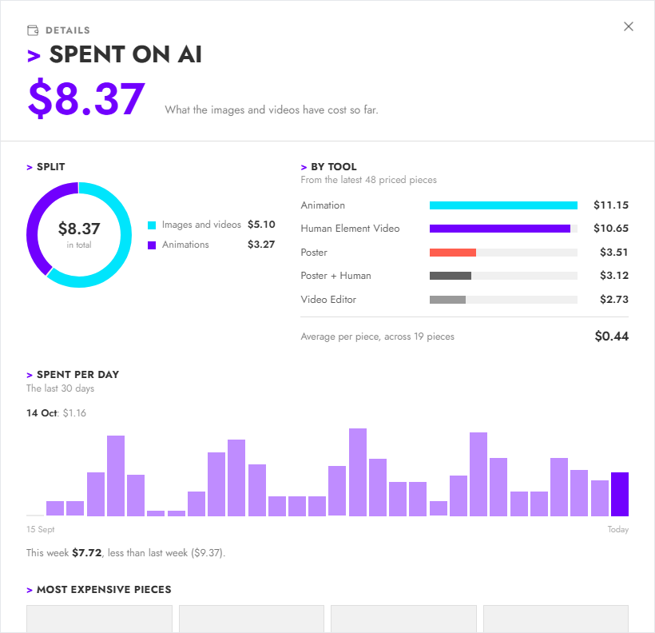 |

### 2. SMAA intelligence: story detail rebuilt
**Before:**
- a "MEASURED / AI OPINION" chip on every block
- "Where this came from" twice
- technical rows ("Id at the source") at the same weight as the story
- the useful line ("How 42 could use this") buried at the bottom

**Now** (`frontend/src/components/trends/TrendDetailDialog.tsx`), in the order you decide:
1. a picture, the headline, the outlet and the plain summary
2. **Worth making?**: the counted number, big (how fresh / against its usual post / how hot), beside the 3 AI scores drawn as rings (Fit for 42, UAE, Opportunity)
3. **How 42 could use this**: the purple 42 block, with Format, Effort and Theme
4. the story, or the Instagram numbers as tiles, with a "this post vs its usual" bar
5. "Why it scored this"
6. **All the details**: every technical row, folded away

Also:
- "Counted" or "AI opinion" is still named on each section, now as a quiet tag.
- The honest lines (no share count, reactions not measured) are kept in All the details.
- The window grows out of the card and shrinks back into it.
- The close bar stays fixed at the top, so nothing scrolls under the X.

| Industry signal (Dark) | Competitor post (Light) |
|---|---|
| 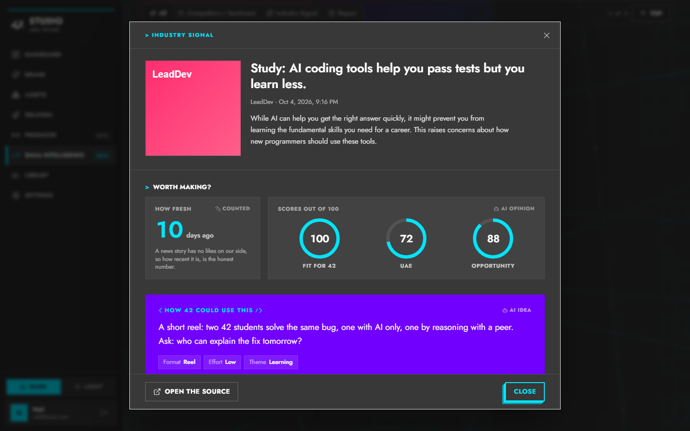 | 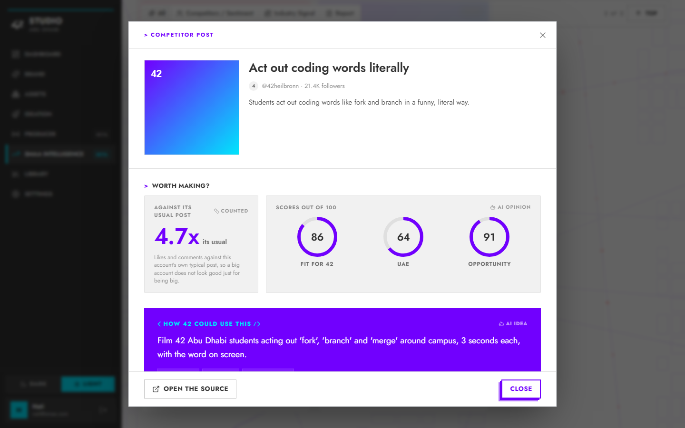 |

| All the details | Phone |
|---|---|
| 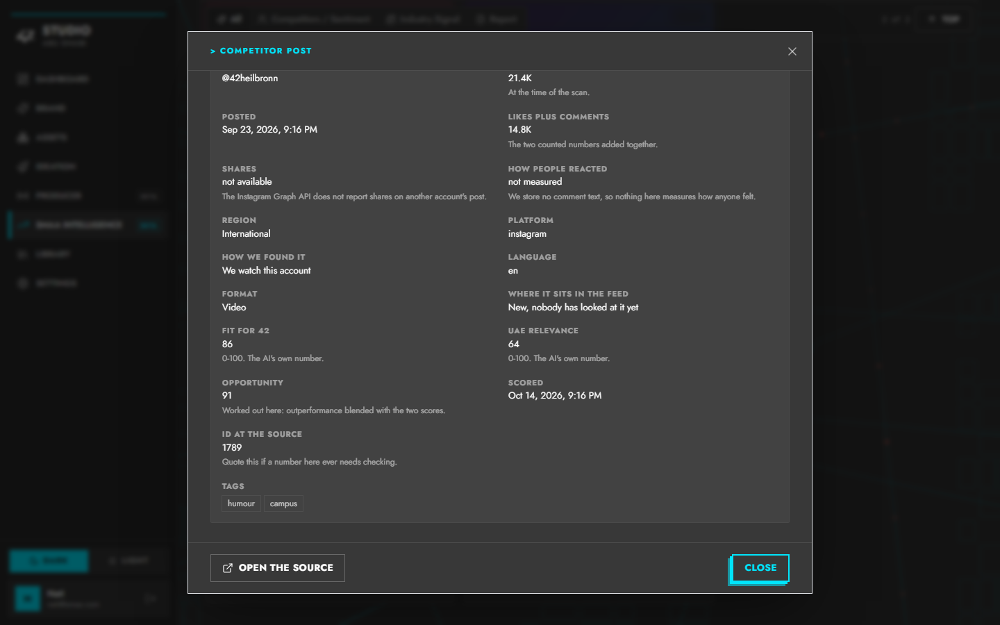 | 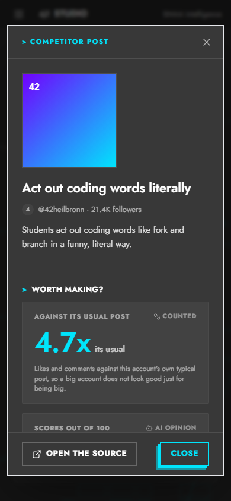 |

### 3. New: "This week" on the Dashboard (REMOVED the same day, see Round 3)
The next 7 days, with every scheduled post as a picture (time and status on it). Every empty day shows "+ Plan a post", which opens Ideation. It reads the existing schedule and never writes.

Nati said the Dashboard should not change, so this is flagged as a decision for the meeting. Removing it is a one-line change.

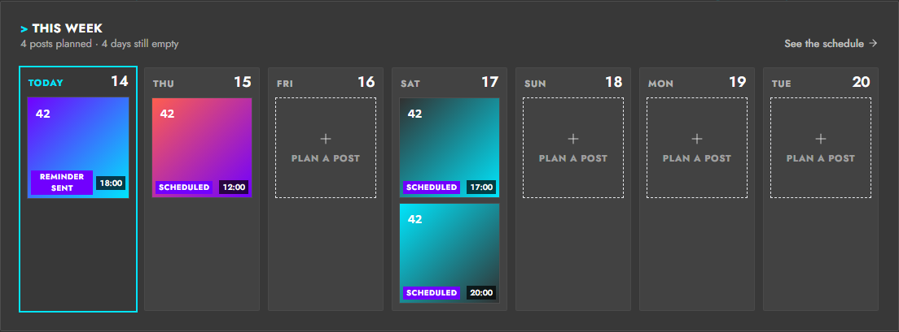

**Not changed:** no backend file, API call or feature.

**Checked:**
- Type check and build pass.
- All 26 screens: 0 errors and 0 sideways scroll.
- Detail windows: tested in Dark and Light at desktop, plus a phone.
- SMAA detail: news story and competitor post, in Dark and Light at desktop, plus a phone. They open, scroll, fold "All the details" open, close with Escape, and focus returns to the card.
- The "Viral social trend" layout passes the type check only. That tab is not in the SMAA tab bar today.

### Honest note: work not saved to GitHub
Everything since 28 Sep is only on this laptop: about 23 changed and 8 new files. The repo access must come back before anything can be pushed, and only to the branch, never main.

## Round 3 (same day): "This week" removed

**Nati's feedback:** "this week new version I really don't like it, just remove please."

**Done:**
- The "This week" section is gone from the Dashboard, and its file (`frontend/src/components/dashboard/WeekPlan.tsx`) is deleted.
- The Dashboard is exactly as it was before: Next step, Where your posts are, the 5 totals (clickable), the charts, Instagram, Your latest work and Make something new.
- The leadership doc no longer mentions it.

**Checked:**
- Type check and build pass.
- Dashboard in Dark, Light and on a phone: the section is gone, no errors and no sideways scroll.

## Round 4 (same day): the Brand profile, shown instead of written

**Nati's feedback:**
- "Brand colors: I want to see the actual brand colour, not just text."
- "What our visuals show is just text, why?"
- "Voice, Colours, Audiences, Messages, Visuals, Phrases, Rules, Notes for the AI must be visualized, not only text."
- "Use the 42 branding I gave you."

**Why the colours could show as text before:** the old swatch could only paint a clean code like `#00E5FC`. A brand guide often writes a colour as "Cyan #00E5FC (buttons)", "rgb(0, 229, 252)", "00e5fc" or just "Black". Those lines painted nothing, so only the words were left.

**Done** (`frontend/src/pages/Brand.tsx` + new folder `frontend/src/components/brand/`):

1. **Colours are always painted now.**
   - The page reads the code out of any line: `#00E5FC`, `00e5fc`, `rgb(...)`, `hsl(...)` and colour names.
   - "Cyan #00E5FC (buttons)" shows the name **Cyan** and the use **buttons**.
   - A name with no code ("Deep purple") gets the closest standard colour, marked **Close match**.
   - A line with no colour at all (for example "Charcoal") shows as a hatched box with "No colour code", so nothing is hidden.
   - Main colours are one wide band, like a real brand guide; supporting colours are a thinner band. Each shows a plain name, the code and the RGB. Click one to copy. A colour widens a little under the mouse.
   - **What to write on each colour:** for every brand colour, the colour to write on it, with how easy it is to read (for example "On Cyan, write in Black · Easy to read · 13.6:1").
   - **Hard to read together:** brand colours that should never be text on each other (for example white on cyan).
   - Visual style words have small pictures (icons).
2. **A sample post at the top.** An Instagram-size post painted with the brand's own colours, in its own font, saying one of its own phrases. **Try another** walks through the colours and phrases.
3. **A map of the book** replaces the "Jump to" words: one tile per section, each with a small picture of what's inside (colour strip, "Aa" in the fonts, icons, Always/Never bar). Click a tile to jump there. On a phone the tiles scroll sideways.
4. **Voice:** the voice words are big 42 headings (`CONFIDENT / WELCOMING / ...`), then **Say it like this** and **Not like this**.
5. **Typefaces:** a full font sample (big "Aag", alphabet, numbers, Regular and Bold, and one of our phrases). Free fonts load for real from Google Fonts. A font that isn't free online (Futura PT) honestly says a stand-in is shown.
6. **Who we talk to / What we talk about:** each one has a matching picture (icon), found from its words: parents, companies, careers, students, free, community and so on.
7. **What our visuals show:** now a mood board with **real pictures**. For each theme it finds matching pictures among our own Instagram posts and the Assets library, using the words in their descriptions. If nothing matches, it says so plainly.
8. **Phrases we use:** each phrase is a small poster in our colours and font. Click to copy.
9. **Brand rules:** a checklist to tick through before a post goes out (Always / Never), with a progress bar and "Start again". Ticks are not saved.
10. **Notes for the AI:** one line per instruction, in a dark 42 "terminal" panel with the cyan `>` and the blinking cursor.
11. The source badge now also understands short values like `priority_1` ("From the brand guide").

**42 branding used:** `> TITLES`, the cyan/purple accents, square corners, the stepped-shadow button, the pixel `<42/>` and `>` marks, the blinking cursor, and the purple/cyan pair on the sample post. None of the rejected Round 4 kit (stacked cards, STEP blocks, pixel headline) is used.

| Top: sample post and the map of the book | Light |
|---|---|
| 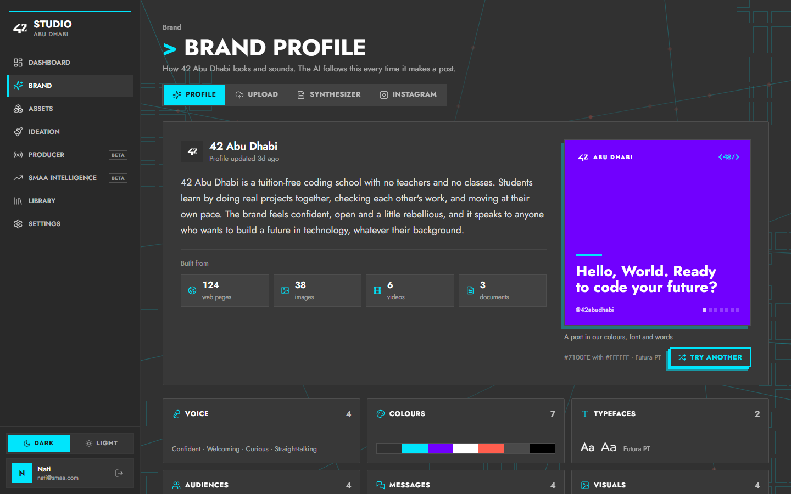 | 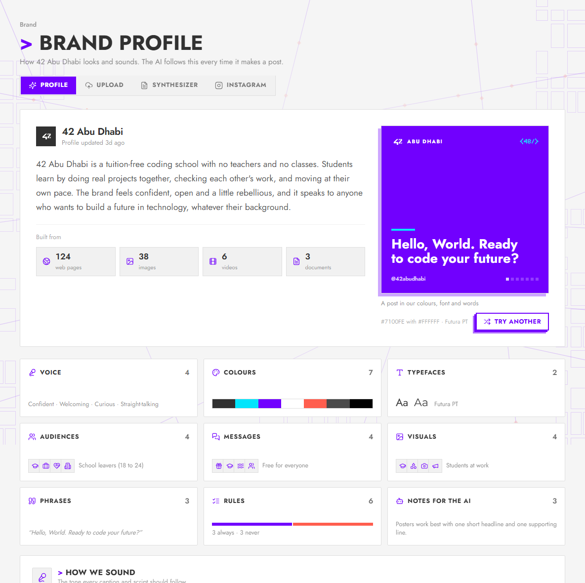 |

| Colours painted | Messy colour lines still painted |
|---|---|
| 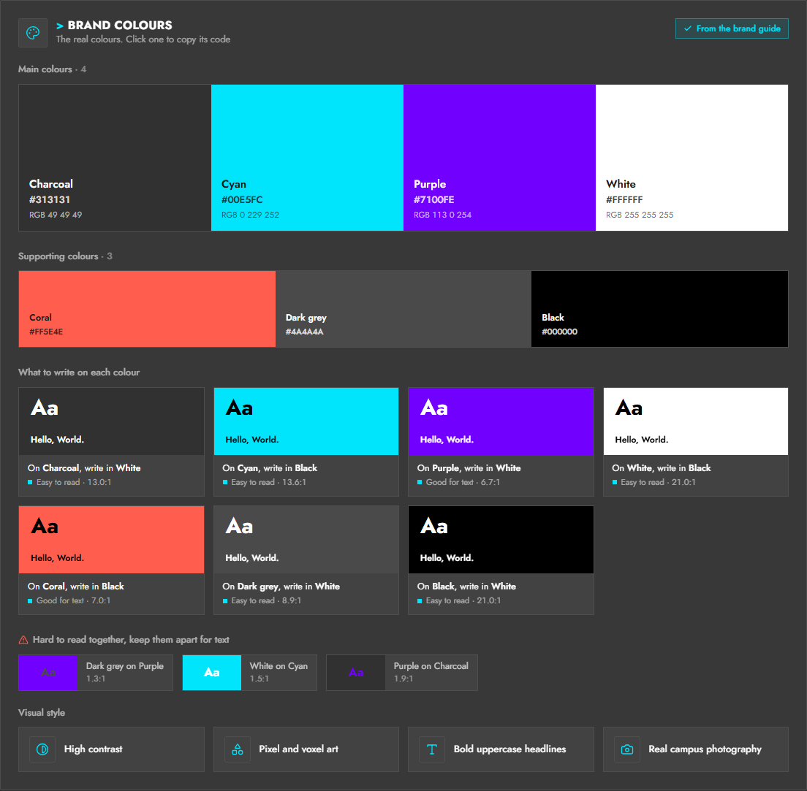 | 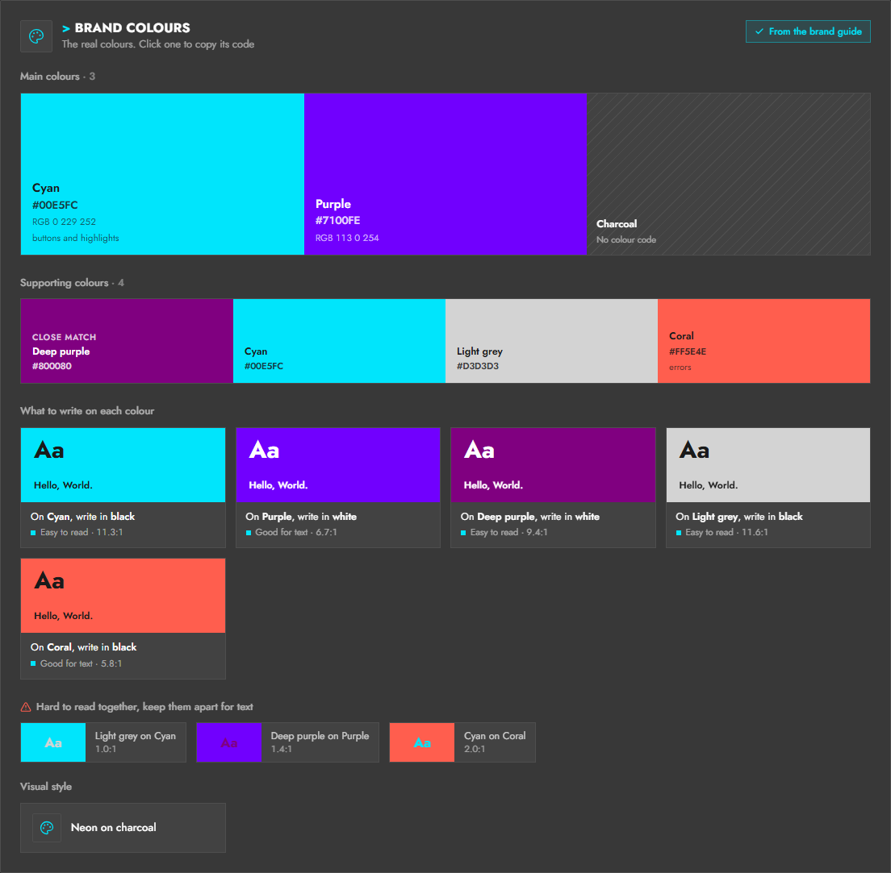 |

| What our visuals show (sample pictures) | Typefaces |
|---|---|
| 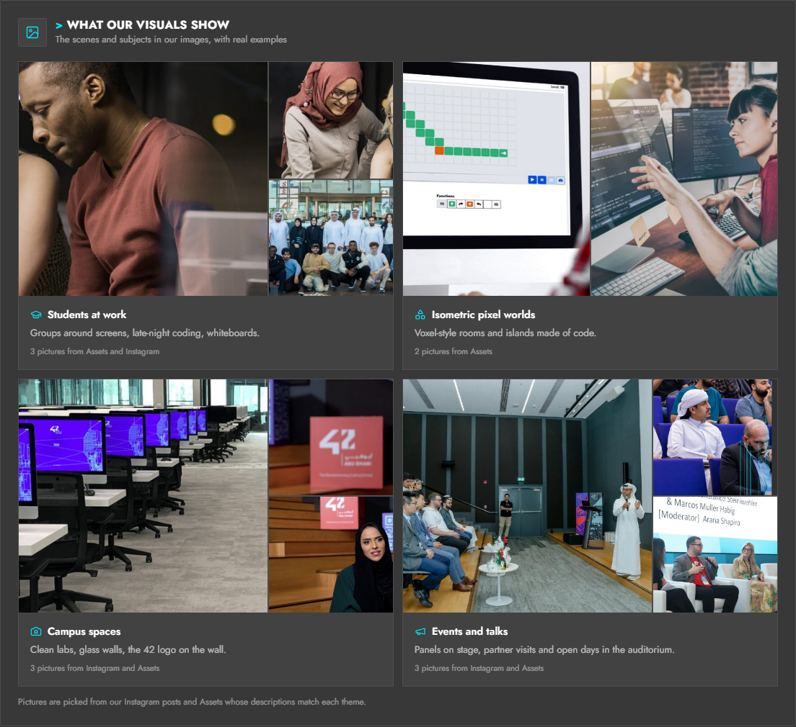 | 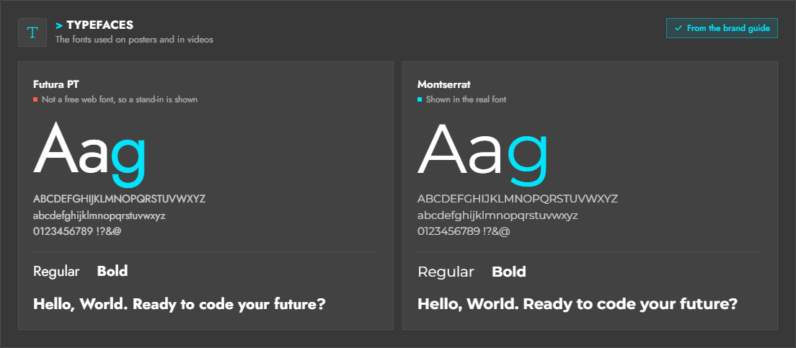 |

| Phrases as posters | Rules checklist |
|---|---|
| 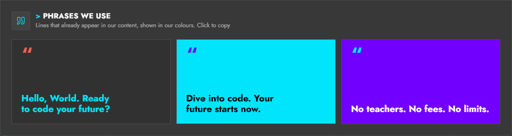 | 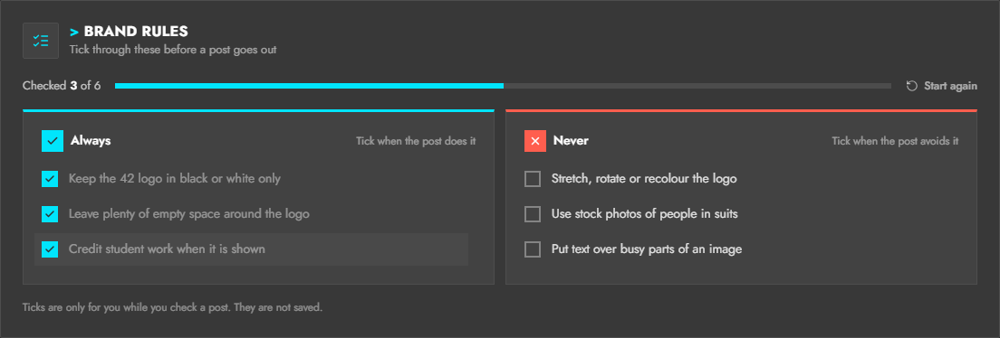 |

| Notes for the AI | Try another | Phone |
|---|---|---|
| 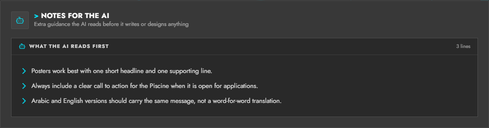 | 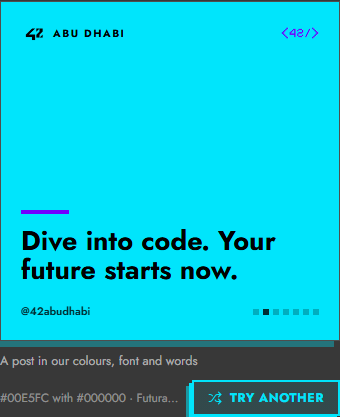 | 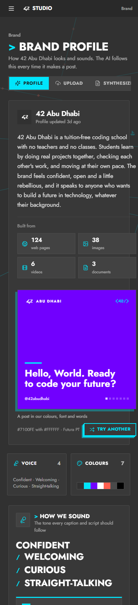 |

The screenshots use test data: 42's real colours, and sample photos from 42abudhabi.ae standing in for Instagram posts and Assets.

**Not changed:** no backend file. The page still reads `GET /api/brand`. To find pictures for the visual themes it also reads two lists that already exist, both read-only: `GET /api/agents/instagram-ingest/posts` and `GET /api/agents/producer/assets?kind=image`.

**Checked:**
- Type check and build pass.
- Brand page in Dark and Light, desktop and phone, with two data sets (clean codes, and messy colour lines with no pictures and a failing Instagram list): no page errors, no sideways scroll, all 11 test pictures load.
- Clicking works: copy a colour, Try another, tick the checklist.
- All 26 screens in both themes: 0 errors, 0 sideways scroll. (The one large white area in Dark is the brand's White swatch, on purpose.)
- Not yet seen with the real studio data: that needs a sign-in on the real-data server.

## Round 5 (same day): "Human Character" button renamed

**Nati's feedback:** change "Human Character" to "AI-generated character"; the icon doesn't fit the word.

**Where:** Ideation, Poster + Human, Template + portrait, the Student photo box (`frontend/src/components/yas/PosterHumanCreator.tsx`).

**Done:**
- The button now says **AI-generated character**.
- Its icon was a grid of 4 squares, the same one as "Pick from Assets", so it said nothing about a person. It is now a person with an AI sparkle.
- The small tag on a chosen picture says "AI-generated character" with the same icon.
- The error message now says "upload one or choose an AI-generated character".

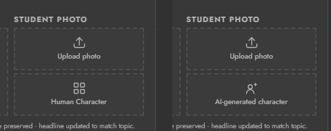

**Not changed:** what the button does (it still opens Assets on the same group), and the backend. The tool name "Human Character" on the Ideation page and the "Human Characters" group in Assets still use the old name (see the question below).

**Checked:** type check and build pass; Poster + Human in Dark and Light, desktop and phone: no errors and no sideways scroll. The label fits on one line on a phone.
