# Design by Nhatty · 42 Studio UI/UX

The one place to see **what changed in the design, when, and why**, and to **leave comments**. It covers the frontend (UI/UX) only. No backend code has been changed.

- Daily detail with every screenshot: [2026-09-28.md](2026-09-28.md)
- Try it locally: `http://127.0.0.1:4242/?demo#dashboard` for the Dashboard with sample numbers, and `http://127.0.0.1:4242/#assets` for Assets.

---

## How to leave a comment

1. Look at the screenshots in the report below.
2. Add a row to the **Team feedback** table at the bottom: your name, the page, and what you'd like changed.
3. Nhatty reviews every row and fills in the **Decision** column: *Yes, will change* / *No, because…* / *Needs discussion*.

Keep each row to one idea. "The gold is too bright on the pipeline" is easier to act on than "I don't like the colours".

---

## The design rules (short version)

| Rule | What it means on screen |
|---|---|
| Official 42 Abu Dhabi branding (since 7 Oct) | Charcoal #313131, cyan #00E5FC, purple #7100FE, coral #FF5E4E for errors and pixel icons. 42 Dark and 42 Light, with a switch. No grid, no gold, no gradients. |
| Square, like the website | Square cards and buttons. Outlined cyan buttons with the stepped shadow. |
| Map background | The 42 website's thin city map behind every page: soft, strongest at the edges, fading out where you read. (The Round 4 cards were removed after Nati's feedback.) |
| Icons | Thin line icons for small controls; coral pixel-art icons on the big cards. |
| Words anyone understands | "Ready to schedule", not "Pending". "Pause", not "Mute". Every screen says what to do next. |
| Quiet motion | Numbers count up, charts draw in, sections rise in gently. All of it switches off for people who turn off animations. |
| Works everywhere | Desktop and phone, keyboard friendly, readable contrast. |

---

## Pages

| Page | Status | Last changed |
|---|---|---|
| Sidebar | Moved to 42 branding (charcoal rail) | 7 Oct 2026 |
| All pages | 42 Dark + 42 Light with a switch, **ready for the 8 Oct meeting** | 7 Oct 2026 |
| Assets (Saved assets) | **Ready for team review** | 28 Sep 2026 |
| Brand: Profile tab | **Visual brand book, ready for review**: colours always painted, sample post, mood board with real pictures, rules checklist | 14 Oct 2026 |
| Brand: Upload, Synthesizer, Instagram tabs | Only the header and tab switch are new; the tab contents keep the old look | |
| Library (History + Scheduled) | **Fully redesigned in 42 style, ready for review** (summary tiles are 42 stacked cards) | 7 Oct 2026 |
| Every page | Soft 42 map line background (Round 5). The Round 4 cards are back to before. | 7 Oct 2026 |
| Ideation: hub, roadmap bar, look of all 7 tools | **Ready for Nati's review** | 28 Sep 2026 |
| Producer, SMAA intelligence, Settings | Re-skinned to 42 through the shared tokens; detailed pass after real-data review | 7 Oct 2026 |

---

## Change report

### Monday 28 September 2026

#### Dashboard (7 rounds with Nati)

| Round | Feedback | What was done |
|---|---|---|
| 1 | "The overview is not cool; the graph is ugly; numbers and icons are not visible" | Full redesign: bigger numbers and icons, a real 14-day chart, a clear pipeline |
| 2 | "The big black panel takes all my attention; use Apple-style glass" | Black removed. Frosted glass panels, a "Next step" card, plain words |
| 3 | "Not glassy enough; add a soft square texture; icons look vibe-coded" | Grid background, real glass, thin ink icons, Per day / Running total chart |
| 4 | "No gradient, no green or blue; this is for a government office" | Ink + white + gold only, flat grid background, calmer glass |
| 5 | "The step cards look flat; add something round" | Round gauges showing each step's share |
| 6 | "Add some cool things" | Count-up numbers, chart draws itself, sections rise in |
| 7 | "A very small blur on the squares" | Grid softened with a 0.7px blur |

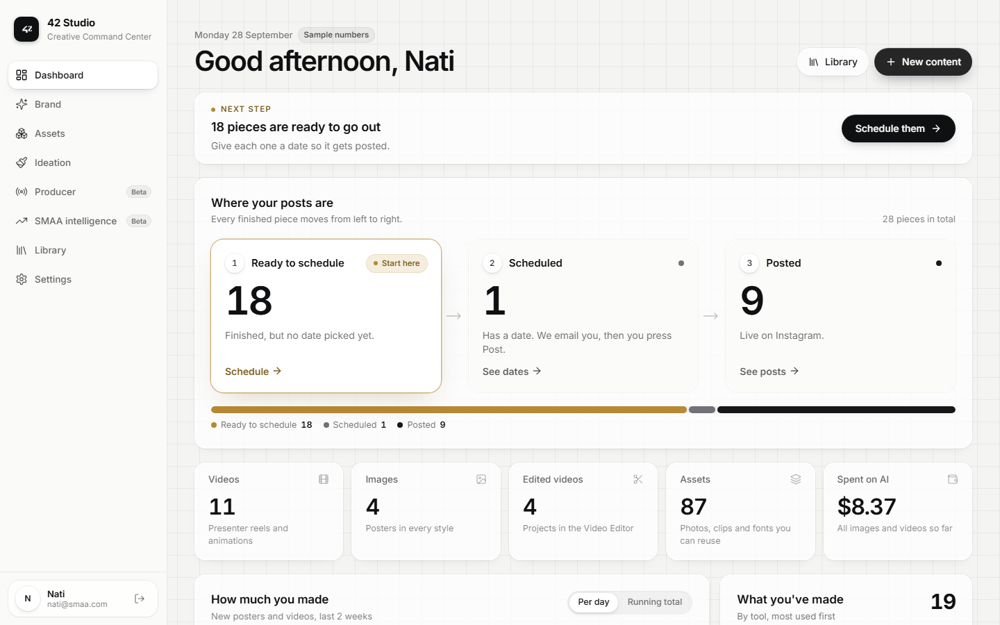

#### Assets page (new today, ready for review)

**Goal:** the same look as the Dashboard, simple enough for anyone, and **everything the backend developers built still works the same way**.

| Before | After |
|---|---|
| Coloured dots and small text on plain cards | Each group shows a **peek of its real pictures**, so people recognise it at a glance |
| No summary | One line: "35 assets in total · 30 images · 5 characters · 2 fonts · 3 music" |
| Plain "← Back" and a bare search box | "All assets" button, big title with its description, a rounded search box with a clear (×) button |
| Image groups had no upload button inside them | **Add asset** button inside every group (opens the same upload window as before) |
| Upload window: one long form | **Three numbered steps**: 1 What kind, 2 Choose files, 3 Name (optional). Each step gets a gold check when done. The footer says what to do next. |
| Asset window: "In rotation / Muted", "Mute / Enable" | "Active / Paused", "Pause / Make active", with icons and a hover hint explaining what it does |
| Technical headings ("Provenance", "Image understanding", "Raw JSON") | "Where it came from", "What the AI sees in it", "Technical view" |
| Empty group: one grey sentence | A friendly empty state with the exact next action and a button |
| Search with no results: blank | "Nothing matches 'x'. Try a shorter word" with a Clear search button |
| Failed to load: red box | A calm card: "Couldn't load your assets", plus the reason |

| Overview | Inside a group |
|---|---|
| 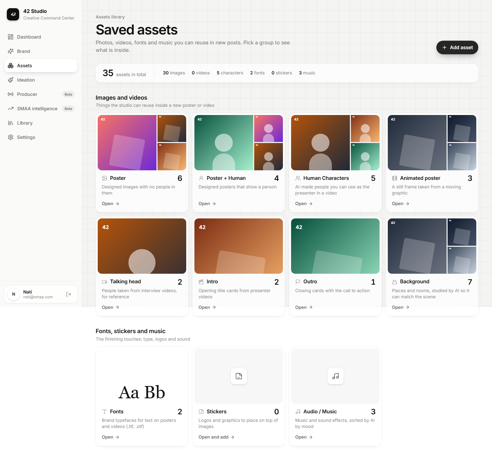 | 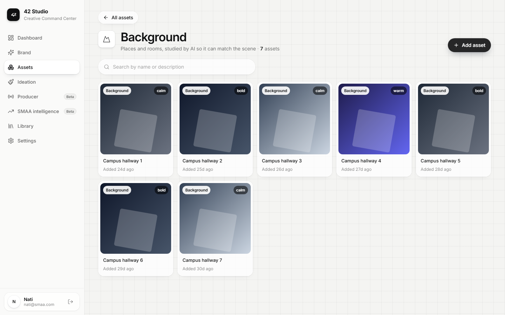 |

| Upload (3 steps) | Asset window |
|---|---|
| 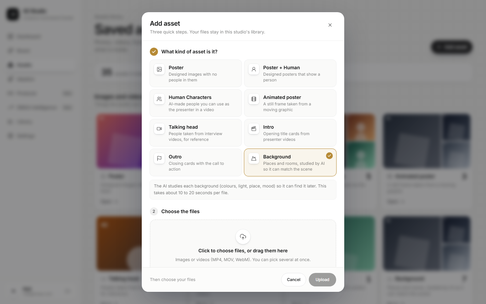 | 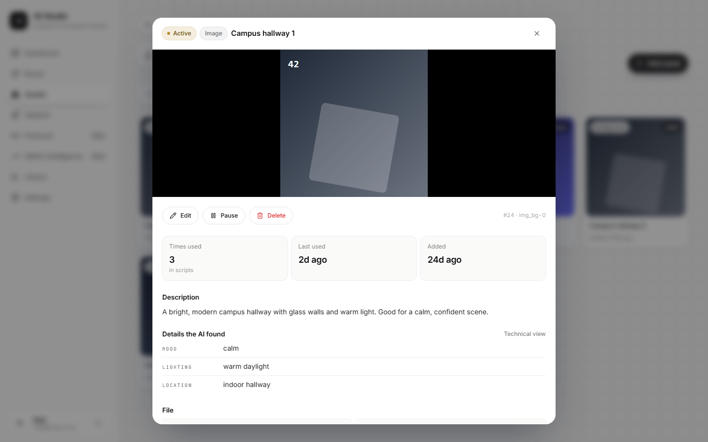 |

More: [music group](assets/2026-09-28/assets-audio.png) · [no search results](assets/2026-09-28/assets-nomatch.png) · [phone](assets/2026-09-28/assets-phone.png) · [when the server fails](assets/2026-09-28/assets-real.png)

**Checked:**
- Type check and production build pass.
- Screenshots in a real browser: overview, a group, search with no results, the music group, the upload window, the asset window and phone width. No page errors and no sideways scrolling.
- Against the real local server: it fails because that database is empty, and the page shows the calm error card and stays usable.

#### Brand page: Profile tab (new today, ready for review)

**Feedback from Nati:** the text on the Brand page is messy. Make it look nice.

**Why it looked messy:** everything was one long column.
- Headings were tiny grey capitals.
- A technical line sat at the top: "run #12 · re-synthesize · synthesized 3d ago".
- Lists were glued together with "·".
- Each audience and theme was one sentence with a dash in the middle.
- Taglines started with a dash.

| Before | After |
|---|---|
| Technical line "run #12 · notes · synthesized 3d ago" | "Profile updated 3 days ago". The run number is still there when you hover over it. |
| Summary as a plain paragraph | A summary card with the 42 logo and easy-to-read text, plus "Built from 124 web pages · 38 images · 6 videos · 3 documents" (this was the number row at the bottom) |
| One long scroll | **"Jump to"** buttons: Voice, Colours, Typefaces, Audiences, Messages, Visuals, Phrases, Rules, Notes for the AI |
| "Voice", "Pillars: A · B · C" | **"How we sound"**: pillars as chips, with **Do** and **Don't** in two tidy cards |
| Small colour squares with tiny codes | **"Brand colours"**: big swatches with readable codes. **Click a colour to copy its code.** |
| Font name in small code text | **"Typefaces"**: a proper specimen card, "Aa" plus a sample line |
| "School leavers — Curious about tech…" | **"Who we talk to"**: one card per audience, name on top and the explanation under it |
| Message themes / visual themes as dash text | **"What we talk about"** and **"What our visuals show"**, as the same cards |
| "— Hello, World…" | **"Phrases we use"**: quote cards |
| Brand do's / don'ts | **"Brand rules"**: **Always** and **Never** cards |
| "Producer notes" in italics | **"Notes for the AI"**: a clear callout with a gold line |
| Source badge "PRIORITY_1… / inferred from website pixels" | "From the brand guide" (gold) or "Guessed from website pictures" (grey) |
| Brand tabs: underline tabs | Glass switch in the same style as the rest (the shared tab bar used by Settings and SMAA intelligence is untouched) |
| Tab explanations with jargon ("Feed the corpus — files or free text become brand_documents…") | Plain words ("Add files or notes about the brand. They are used the next time the profile is rebuilt.") |
| Empty profile: one grey sentence | A clear empty state with an **Open the Synthesizer** button |

| Top of the Profile | Colours (click to copy) |
|---|---|
| 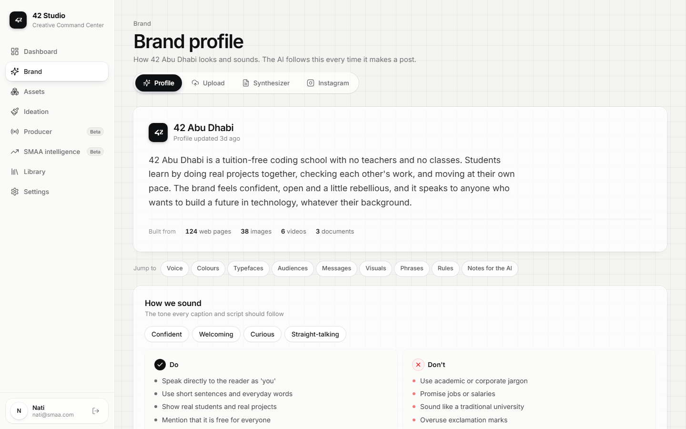 | 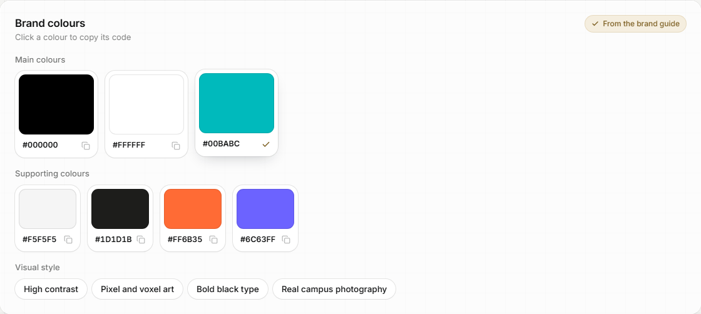 |

More: [full Profile page](assets/2026-09-28/brand-profile.png) · [phone](assets/2026-09-28/brand-phone.png) · [when the server fails](assets/2026-09-28/brand-real.png)

**Checked:**
- Type check and production build pass.
- Full page and phone screenshots with a realistic profile: no page errors and no sideways scrolling. On a phone the tab switch scrolls inside its own strip.
- Click-to-copy tested with real clipboard access: the clipboard holds `#00BABC`, and the "Colour code copied" notice appears. If a browser blocks the clipboard, the notice shows the code instead.
- All four Brand tabs open with no errors. Against the real (empty) local server, the Profile shows the calm error card.

#### Ideation (new today, waiting for Nati's review)

**Goal:** make Ideation look amazing and easy, the place where content gets made. Everything the backend developers built still works exactly the same way. No generation, resume or link logic was touched.

**1. The hub: "What do you want to make?"**

| Before | After |
|---|---|
| Plain cards with a coloured dot and one line | Each tool has its own **line drawing** showing what comes out of it (a poster, a moving poster, a poster with a person, a reusable person, a talking video, "describe → video"). They are ink lines with one gold touch. They are drawn in code, so they load instantly and look right with an empty library. |
| No hint of what you get | A small tag on every card: **Image / Short video / Video / Saved to Assets / 2 ways** |
| Small centred heading | Big clear heading plus one line: "Pick one. We guide you step by step, from the first idea to posting it on Instagram." |
| Video Editor as a plain wide card | Under **"Already have footage?"**: a wide card with a timeline drawing |
| General video sub-choice: plain cards, "← All tools" | "Which kind of video?", drawings for General AI Video and B-roll, and an "All tools" button |

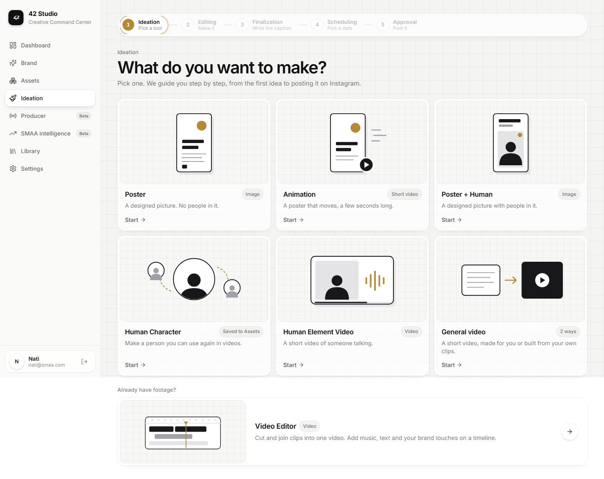

**2. The roadmap bar (on every Ideation screen)**

| Before | After |
|---|---|
| "ROADMAP" label, small boxes with arrows | A glass bar with 5 numbered steps. Each step has a plain hint: Ideation "Pick a tool" · Editing "Make it" · Finalization "Write the caption" · Scheduling "Pick a date" · Approval "Post it" |
| Teal active step | **Gold** ring for "you are here", a **black check** for steps you have finished, and faded steps you can't reach yet |
| Small "Copy link" | Rounded **Copy link** button on the right |

**3. The inside of all 7 tools and the Finalization, Scheduling and Approval steps**

Instead of rewriting each tool (thousands of lines of delicate generation code), one **styling layer** now wraps them, called `.studio-ui`:

| Before | After |
|---|---|
| Labels in tiny monospace capitals: "WHAT'S THE POST ABOUT?" | Normal readable labels: "What's the post about?" |
| Teal selection borders, teal buttons, teal progress bars | **Ink**, matching the Dashboard (the teal on other pages is unchanged) |
| Flat white cards | Quiet glass cards with soft shadows |
| Square buttons and inputs | Rounded, the same as the rest of the redesign |
| White page | The same soft grid background as Dashboard, Assets and Brand, only while Ideation is on screen |

| Poster tool | Human Element Video |
|---|---|
| 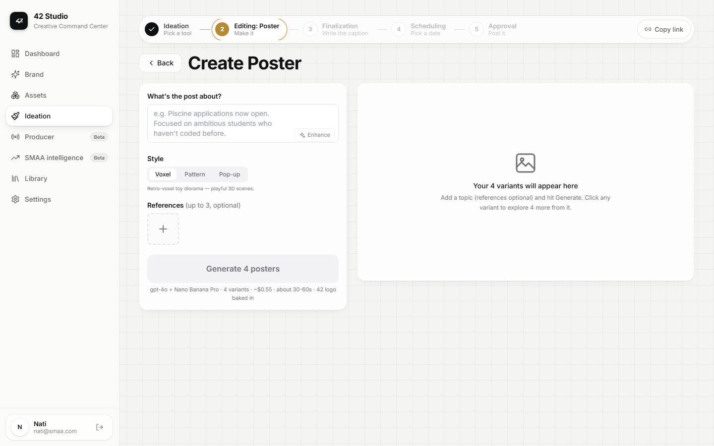 | 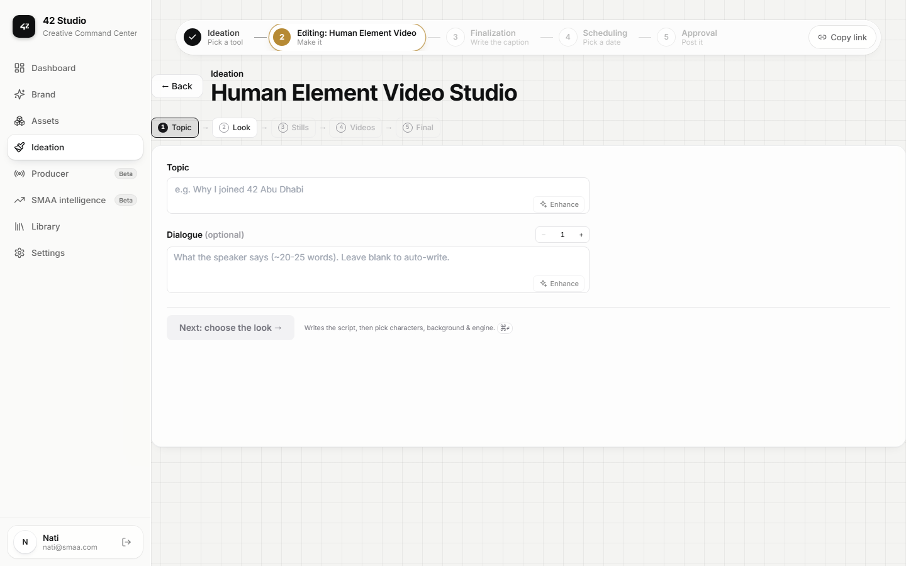 |

All tools: [Animation](assets/2026-09-28/tool-animation.png) · [Poster + Human](assets/2026-09-28/tool-poster_human.png) · [Human Character](assets/2026-09-28/tool-human_character.png) · [General AI Video](assets/2026-09-28/tool-general_video.png) · [B-roll](assets/2026-09-28/tool-broll.png) · [General video choice](assets/2026-09-28/ideation-general.png) · [phone](assets/2026-09-28/ideation-phone.png)

**Checked:**
- Type check and production build pass. The dev server was restarted after the colour change.
- All 7 tools open from their links with no page errors. Inside every tool the accent is ink.
- **Outside Ideation nothing changed:** on Settings and Library the teal still measures exactly `rgb(6, 182, 162)`.
- The grid background follows the visible tab:
  - On for Ideation and Dashboard.
  - Off for Library and Settings (not redesigned yet), even though Ideation stays loaded in the background.
- Phone: no sideways scrolling. The roadmap bar scrolls inside itself.

**Known and left for the next round (after Nati's feedback):**
- Human Element Video Studio uses its own full-width layout, so its panel runs to the screen edge.
- Its inner step chips (Topic → Look → Stills → Videos → Final) still have the old style.
- The Video Editor keeps its own look. It has dark screens, and the new ink accent could be hard to see on them.
- Small grey technical lines inside tools (for example "gpt-4o + Nano Banana Pro · 4 variants · ~$0.55") are unchanged. The team may want those in plain words too.

### Wednesday 7 October 2026

**Team feedback:** the grid background and the gold are out. Use the official **42 Abu Dhabi branding** from 42abudhabi.ae.

| What changed | Detail |
|---|---|
| Brand source | 42abudhabi.ae, studied in a real browser: charcoal #313131, cyan #00E5FC, purple #7100FE, Futura bold UPPERCASE, `<CODE/>` brackets, the offset-shadow button |
| Two options built | Dashboard and sidebar in **42 Dark** (like the website) and **42 Light** (charcoal frame, light content). Nati chooses. |
| Background | The grid and gradients are removed. Plain charcoal (Dark) or light grey (Light). |
| Accent | Gold is replaced by 42 cyan (actions, "needs you") and purple (scheduled, accent text in Light) |
| Type | Jost, a free Futura-style font, for headings and numbers. Headline: "> GOOD EVENING, <NATI/>" |
| Sidebar | 42 charcoal rail, white 42 logo, cyan rule, cyan "you are here" |

| 42 Dark | 42 Light |
|---|---|
|  |  |

**Round 2, same day:**
- Every page has moved to the real 42 look in both themes: square shapes, outlined cyan buttons, purple feature blocks, Futura capitals, "> TITLE" headings, and coral for errors.
- A Dark/Light switch sits in the sidebar.
- Meeting brief: [MEETING_2026-10-08_42_BRANDING.md](MEETING_2026-10-08_42_BRANDING.md).

| All pages, 42 Dark | All pages, 42 Light |
|---|---|
| 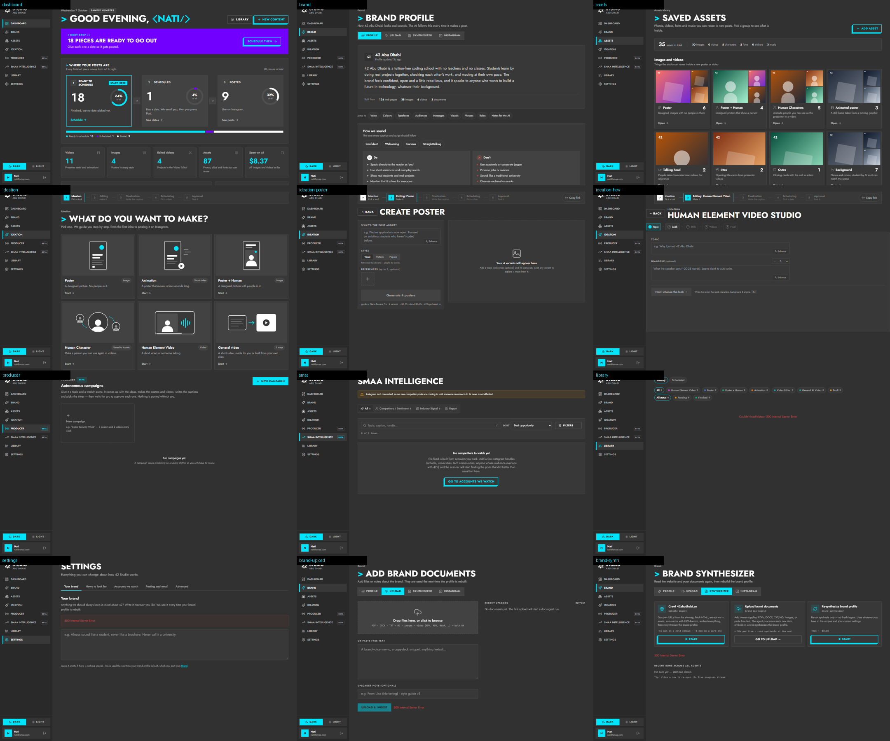 | 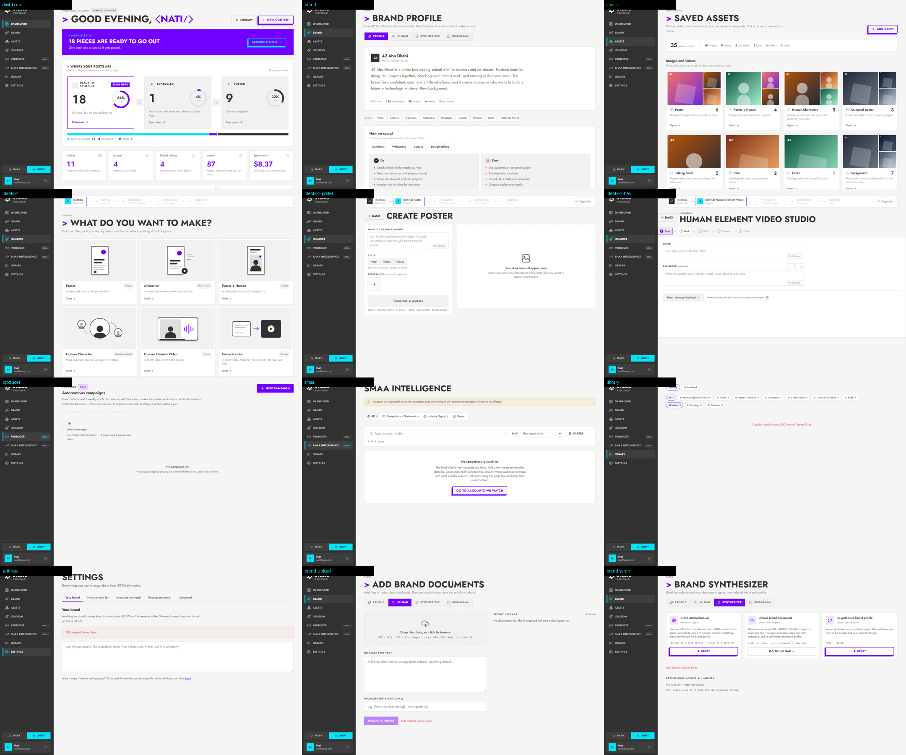 |

**Round 3, same day: the Library page** is fully redesigned.
- A "> YOUR WORK" title.
- Summary tiles that double as the status filter.
- A title search.
- Square tiles with a readable type label and a cyan "CONTINUE → STEP".
- A Scheduled tab in the 42 colours.

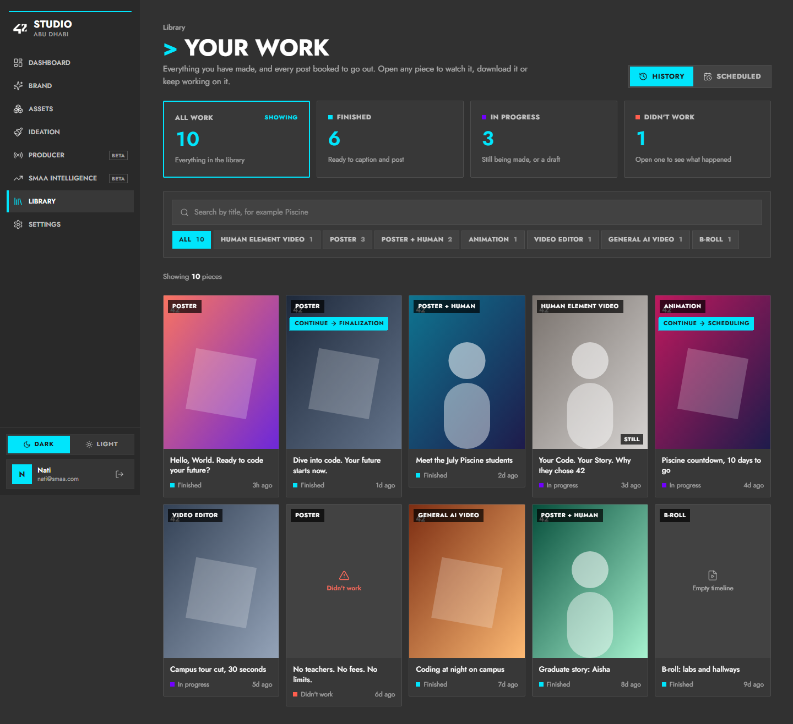

**Round 4, same day: the 42 website's own components.**
- A reusable 42 kit is used on the Dashboard, Ideation, Library, Assets and Brand: stacked cards with a frame behind, coral pixel icons, `ZERO < TUITION />`-style headings, the pixel headline "< Nati_ >" with a blinking coral cursor, the cyan line-art map, the purple "> THE STUDIO IN NUMBERS" block and purple STEP 1/2/3 cards joined by circuit lines.
- **Strong test:**
  - 26 screens with 0 errors.
  - 3 screen sizes with 0 sideways scroll.
  - Measured contrast: 0 failures after the fixes.
  - Keyboard, clicks and reduced motion all checked.

| Dark | Light |
|---|---|
| 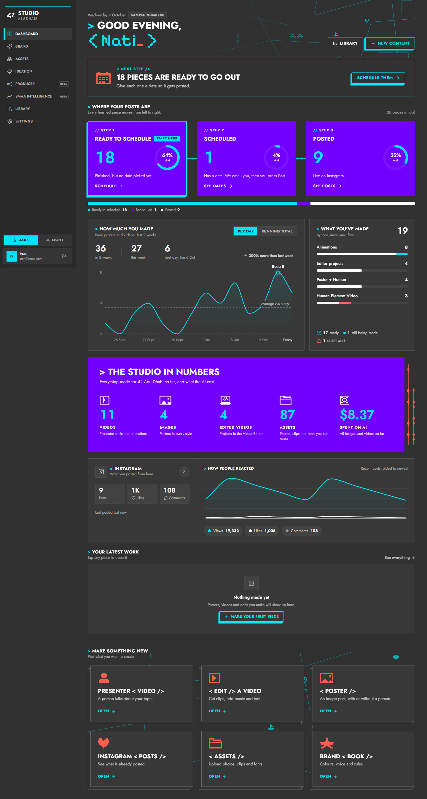 | 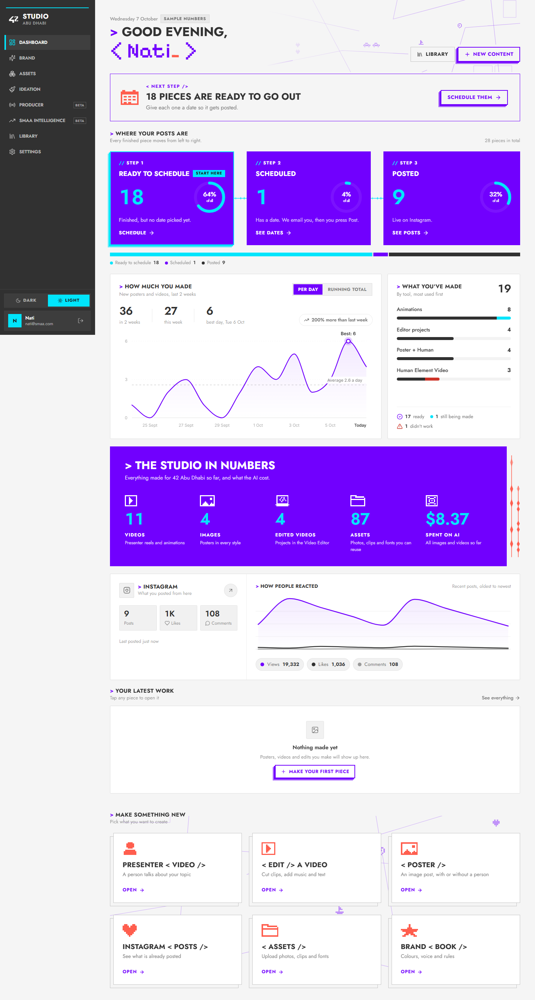 |

**Round 5, same day: Nati's correction.**
- The Round 4 cards are removed and every page is back to its earlier design.
- Only the **map line background** stays, as Nati asked: soft, behind **every page**, in both themes.

| Ideation, Dark | Settings, Light |
|---|---|
| 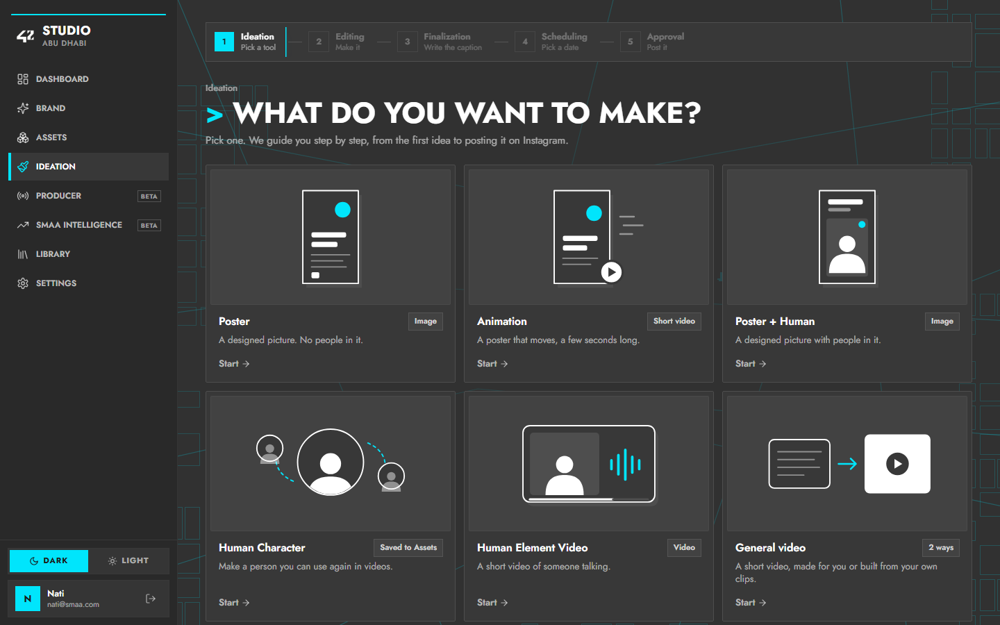 | 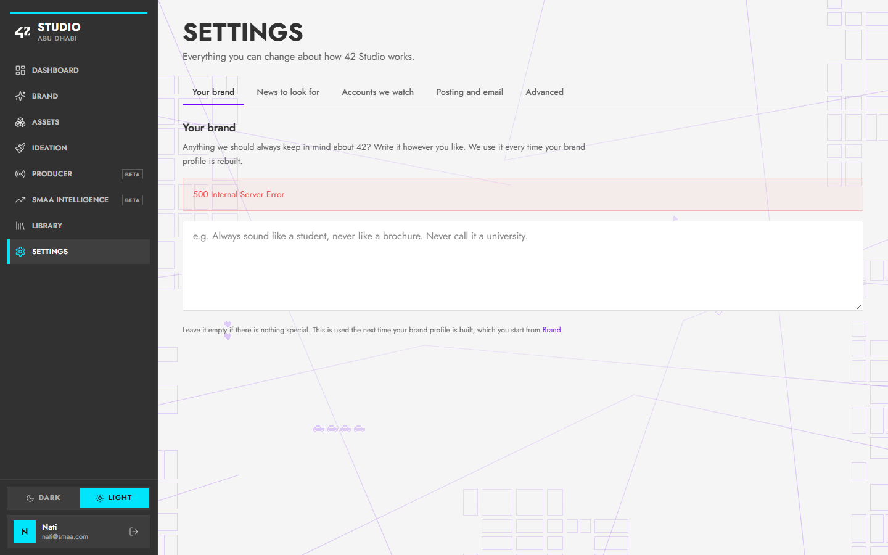 |

Details: [2026-10-07.md](2026-10-07.md)

---

## Words we changed (please confirm)

These are label changes only. The data and the backend are untouched.

| Where | Before | Now | Why |
|---|---|---|---|
| Dashboard pipeline | Not scheduled | Ready to schedule | Says what to do |
| Dashboard | Production | What you've made | Everyday words |
| Dashboard | Activity | How much you made | Everyday words |
| Dashboard | Engagement | How people reacted | Everyday words |
| Dashboard totals | Editor projects / AI spend | Edited videos / Spent on AI | Everyday words |
| Asset window | In rotation / Muted | Active / Paused | "Rotation" is jargon |
| Asset window button | Mute / Enable | Pause / Make active | Matches the status words |
| Asset window | Used 3× · In scripts | Times used 3 · in scripts | Easier to read |
| Asset window | Image understanding | What the AI sees in it | Everyday words |
| Asset window | Provenance | Where it came from | Everyday words |
| Asset window | Attributes / Raw JSON | Details the AI found / Technical view | Everyday words |
| Category descriptions | e.g. "Locations & environments — vision-analyzed for scene reference" | e.g. "Places and rooms, studied by AI so it can match the scene" | Everyday words |
| Brand profile | Voice / Pillars | How we sound | Everyday words |
| Brand profile | Visual identity / Primary, Secondary colours | Brand colours / Main, Supporting colours | Everyday words |
| Brand profile | Audiences / Message themes / Visual themes | Who we talk to / What we talk about / What our visuals show | Everyday words |
| Brand profile | Taglines / phrases | Phrases we use | Everyday words |
| Brand profile | Brand do's / don'ts | Brand rules: Always / Never | Clearer as rules |
| Brand profile | Producer notes | Notes for the AI | Says who reads it |
| Brand profile | Jump to | A map of the book (picture tiles) | Shows what's inside |
| Poster + Human, Student photo | Human Character | AI-generated character | Says what it is (Nati) |
| Brand profile | Voice Do / Don't | Say it like this / Not like this | Everyday words |
| Brand profile | Brand rules | Tick through these before a post goes out | It is a checklist now |
| Library | (no title) | > YOUR WORK | Says where you are |
| Library | Pending / Finished chips | In progress / Finished tiles (plus Didn't work) | Everyday words |
| Library tiles | failed / (untitled) / hover to play | Didn't work / Untitled / Video tag | Everyday words |
| Scheduled tab | Reminded / Failed / Retry → | Reminder sent / Didn't post / Try again | Everyday words |
| Brand profile badges | inferred from website pixels | Guessed from website pictures | Everyday words |
| Ideation hub | What do you want to create? | What do you want to make? | Everyday words |
| Ideation hub tag | (none) | Image / Short video / Video / Saved to Assets | Says what you get |
| Roadmap bar | Roadmap | Step hints: Pick a tool · Make it · Write the caption · Pick a date · Post it | Says what happens in each step |

Category **names** (Poster, Poster + Human, Human Characters, Animated poster, Talking head, Intro, Outro, Background, Fonts, Stickers, Audio / Music) are **unchanged**, because the team already knows them.

---

## Questions for the team

1. **"Active / Paused"** in the asset window: is this clearer than "In rotation / Muted" for you?
2. **Theme:** 42 Dark (like 42abudhabi.ae) or 42 Light (charcoal frame)? Gold has been replaced by the 42 cyan and purple.
3. **Add asset inside a group:** when you press it inside "Background", should the upload window already have "Background" selected? It doesn't yet. That would be a small frontend change.
4. **Ideation technical lines:** should lines like "gpt-4o + Nano Banana Pro · 4 variants · ~$0.55" become plain words ("Makes 4 versions · about 30 to 60 seconds · about $0.55")?
5. **Accent everywhere:** the teal is still used on pages not yet redesigned (Library, Settings, SMAA intelligence). Switch them all to ink now with one line, or wait for each page's redesign?
6. **Map background (Round 5):** is it soft enough, or should it be a little stronger or weaker?
7. **"AI-generated character" everywhere?** The Poster + Human button is renamed. Should the Ideation tool "Human Character", the Assets group "Human Characters" and the picker chip use the same words?
8. **What next after Ideation feedback:**
   - Library?
   - Or the other Brand tabs (Upload, Synthesizer, Instagram)?
   - Or the inside of Human Element Video Studio?

---

## For developers: what was NOT changed

- **Backend:** no files under `backend/` were touched.
- **Assets API calls, all identical:**
  - `GET /api/agents/producer/assets?limit=500`
  - `POST /api/agents/producer/assets/upload-simple` (with `content_category` and `display_name`)
  - `api.producerAssets.upload` for fonts, stickers and audio
  - `GET` / `PATCH` / `DELETE /api/agents/producer/assets/{id}`
  - the `/file` and `/preview` thumbnail URLs
- **Category keys** (`img_poster`, `img_bg`, `k_font` …) and total keys (`cat_img_poster` …) are unchanged. Only the words people read changed.
- **Frontend files changed today:**
  - `pages/Dashboard.tsx`, `pages/Assets.tsx`, `components/assets/AssetDetail.tsx`
  - `pages/Brand.tsx`, `pages/BrandWorkspace.tsx` (Brand uses only `GET /api/brand`, unchanged)
  - Ideation:
    - `components/yas/roadmap/ProducerRoadmap.tsx`: only the hub layout, the roadmap bar and `studio-ui` wrappers. All state, resume and deep-link logic is untouched.
    - `GlobalStepper.tsx`
    - new: `ToolIllustration.tsx`
  - `components/Sidebar.tsx`, `components/auth/AccountFooter.tsx`
  - `styles.css`, `tailwind.config.ts`, `index.html`
  - new: `lib/useStudioCanvas.ts`
- **New shared design pieces** you can reuse on other pages:
  - Styles: `.glass`, `.glass-inset`, `.icon-well`, `.segmented`
  - Colour tokens: `gold` / `gold-ink` / `gold-soft`
  - Canvas: the `useStudioCanvas()` hook
  - Animations: `animate-reveal`, `animate-drawLine`
- **Accent is now a CSS variable:** `--accent-rgb`, default teal `6 182 162`. `.studio-ui` sets it to ink for everything inside, and one line in `styles.css` can re-point it for any area.
- **`useStudioCanvas(active)`:** keeps a count of which pages want the canvas, so the Ideation studio (mounted but hidden) and another page never fight over it.
- **Gotcha:** restart `npm run dev` after editing `tailwind.config.ts`, or new colours show up as default blue.

---

## Team feedback

| Date | Name | Page | Comment | Decision | Status |
|---|---|---|---|---|---|
| 14 Oct 2026 | Nati | Ideation: Poster + Human | Change "Human Character" to "AI-generated character"; the icon doesn't fit the word | Renamed; the grid icon is now a person with an AI sparkle | Done |
| 14 Oct 2026 | Nati | Brand profile | Show the actual brand colours, not text. "What our visuals show" is just text. Voice, Colours, Audiences, Messages, Visuals, Phrases, Rules, Notes must be visual. Use the 42 branding. | Rebuilt as a visual brand book (see 14 Oct, Round 4) | Done, check with real data |
| 14 Oct 2026 | Nati | Dashboard detail windows | The Assets window is nice; make Videos, Images and Spent on AI the same | Same layout for all 5 windows | Done |
| 14 Oct 2026 | Nati | SMAA intelligence | I really hate the story detail; make something amazing | Rebuilt: story, Worth making? rings, How 42 could use this, All the details | Done |
| 14 Oct 2026 | Nati | Dashboard | Do not change the Dashboard look | Look kept | Done |
| 14 Oct 2026 | Nati | Dashboard "This week" | I really don't like it, just remove it | Removed, and its file deleted | Done |
| 14 Oct 2026 | Nati | Sign-in | Update the login page | Redesigned: charcoal brand panel with the city map, new form, Dark/Light switch (fixes the white panel in Dark) | Done |
| 11 Oct 2026 | Nati | Dashboard totals | Make the totals clickable, with a detail popup, small charts and smooth animation | Built: each total opens a window that grows out of the tile, with charts and the latest pieces | Done |
| 7 Oct 2026 | Nati | Dashboard header | Mistake in the Library / New content buttons | Map lines showed through the see-through buttons; buttons are now solid and further apart | Done |
| 7 Oct 2026 | Nati | All pages | Bring back the animation I liked; charts should animate too, and stay fast | Running light on the map is back; charts draw in when scrolled to | Done |
| 7 Oct 2026 | Nati | All pages | Show the redesign with the real data for the meeting | Dev server can read api.42studio.fit (sign in, read-only screenshots) | Done |
| 7 Oct 2026 | Nati | All pages | Round 4 cards (stacked cards, purple STEP and stats blocks, pixel headline) look ugly; it was nicer before. Only the map background is good; show it softly on every page. | Removed the Round 4 cards; soft map background on every page | Done |
| | | | | | |
| | | | | | |
| | | | | | |
