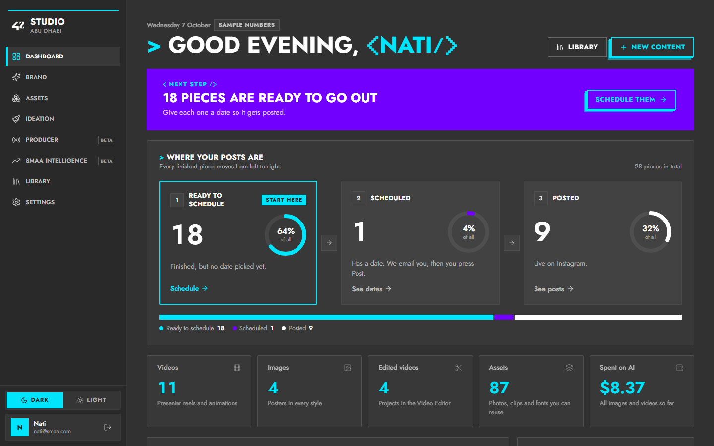
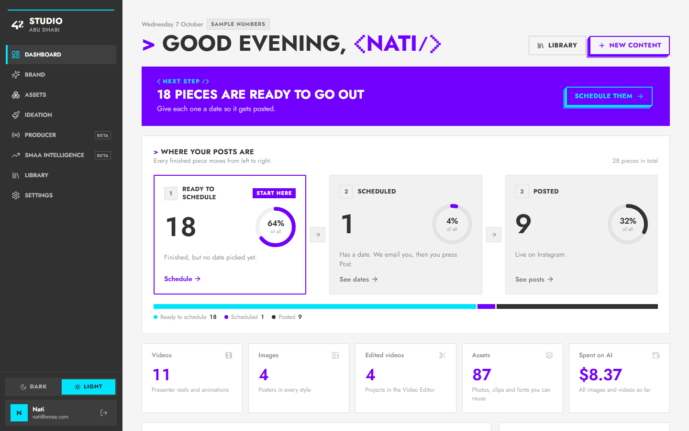

# 42 Studio × 42 Abu Dhabi branding · meeting brief

**Meeting:** Thursday 8 October 2026
**Prepared by:** Nati (UI/UX)
**Topic:** 42 Studio now uses the official 42 Abu Dhabi brand, in a dark and a light theme, on every screen.

---

## 1. The one-minute version

- 42 Studio (the in-house content studio) now **looks like 42abudhabi.ae**: the same charcoal, cyan, purple and coral, the same Futura capitals, square shapes, outlined cyan buttons with a stepped shadow, and the `<CODE/>` brackets.
- **Two themes, one switch** at the bottom of the sidebar:
  - **42 Dark** is the website's look.
  - **42 Light** is the website's white sections, like the About page.
- **Every screen is converted:** Dashboard, Brand (all 4 tabs), Assets, Ideation (hub and all 7 tools), Producer, SMAA intelligence, Library and Settings.
- **Frontend only.** No backend changes, and every feature works as before.

| 42 Dark | 42 Light |
|---|---|
|  |  |

---

## 2. What the 42 Abu Dhabi brand is (studied on 42abudhabi.ae)

| Element | What 42abudhabi.ae does | Evidence |
|---|---|---|
| Ground | Charcoal **#313131**, never pure black. White sections on some pages (About). | [Home](assets/2026-10-07/ref-x-home-1.png), [About](assets/2026-10-07/ref-x-about-0.png) |
| Signature colour | Electric **cyan #00E5FC**: buttons, the active menu underline, rule lines, key words | [Home](assets/2026-10-07/ref-42abudhabi-home.png) |
| Second colour | Electric **purple #7100FE**: big feature blocks (news cards, footer), curriculum circles | [News](assets/2026-10-07/ref-x-news-1.png), [Footer](assets/2026-10-07/ref-x-footer.png) |
| Third colour | **Coral #FF5E4E**: map line-art, pixel words, circuit lines | [About](assets/2026-10-07/ref-x-about-0.png), [Journey](assets/2026-10-07/ref-x-journey-1.png) |
| Type | **Futura PT**: bold UPPERCASE headings, light body text. A pixel font (VG5000) for brackets and playful lines. | [How to apply](assets/2026-10-07/ref-x-apply-1.png) |
| Shape | **Square.** 441 of 444 elements measured at a 0px corner radius. | measured in a real browser |
| Buttons | Transparent with a thick cyan outline, cyan UPPERCASE text, and a 3-step solid offset shadow: "APPLY < NOW >", "READ < POST >" | [News](assets/2026-10-07/ref-x-news-1.png) |
| Headings | "> TITLE", with key words as `<WORD/>`: "> MEET OUR <STUDENTS/>", "ABOUT <42 ABU DHABI/>" | [About](assets/2026-10-07/ref-x-about-0.png) |
| Lists | Square boxes with a thin 1px cyan outline and small pixel chevrons | [Piscine status](assets/2026-10-07/ref-x-piscine-0.png) |

**Accessibility finding:** cyan on white has a contrast of only 1.4:1, while readable text needs 4.5:1. So in 42 Light, cyan is used only as a fill, and **purple carries the coloured text**. The website does the same in its white sections.

---

## 3. How the studio uses each element

| 42 brand element | Where it is in 42 Studio |
|---|---|
| Charcoal ground and white type | 42 Dark: every page. The sidebar is charcoal in both themes, like the website header. |
| Cyan | Main buttons, "you are here" in the sidebar (a thick cyan bar), "Start here" on the Dashboard, chart lines, key numbers |
| Purple feature block | The Dashboard's **"Next step"** card is a purple block with a cyan outlined button, like the website's news cards |
| Coral | Errors and "didn't work" |
| Futura capitals | Page titles, section titles, buttons and menu items, using **Jost**, a free font made after Futura (Futura PT is a paid font) |
| `> TITLE` and `<WORD/>` | Every page title starts with a cyan "> ". The Dashboard greets with **"> GOOD EVENING, <NATI/>"**, with pixel-font brackets. |
| The 42 button | Every main action: outlined, stepped solid shadow, and it presses into its shadow when clicked |
| Square shapes | Cards, inputs, buttons, tabs and badges are all square. Only avatars and status dots stay round. |
| Light theme | The website's white sections: white ground, charcoal type, purple accents |

**All screens, both themes:**

Individual screens are in `assets/2026-10-07/` (`dark-*.png` and `light-*.png`).

---

## 4. How to show it live

1. Start the studio locally (see the README), then open `http://127.0.0.1:4242/?demo#dashboard`. The Dashboard fills with sample numbers so the charts show. This only works locally; the live site never shows sample numbers.
2. Switch **Dark / Light** with the switch above the account card in the sidebar.
3. Good screens to show: Dashboard → Brand → Ideation (hub, then the Poster tool) → Assets.

---

## 5. Questions to settle in the meeting

1. **Default theme for everyone:** Dark (like the website) or Light? Both stay available either way.
2. **Font:** the studio uses Jost, a free Futura look-alike. Does 42 Abu Dhabi want us to use the licensed **Futura PT** files? That needs their web licence.
3. **Pixel font:** the website uses **VG5000** for brackets. We use a close free match (Pixelify Sans). Should we switch to VG5000 itself? It's free and open-licence.
4. **Arabic:** the website pairs IBM Plex Sans Arabic with Futura. Should the studio support Arabic?
5. **Coral:** right now it only marks errors. Should it be used more, for example in charts?

---

## 6. What was checked

- **Build:** type check and production build pass.
- **Every page in both themes in a real browser (26 screens):** no page errors, no sideways scrolling, and no white panels left in Dark (checked automatically).
- **Labels:** every sidebar and step label fits without being cut off. The sidebar is 16px wider for this.
- **No regressions:** no backend files changed, and all API calls are unchanged.

## 7. Known open items

- **GitHub:** the repository `agegnew/42-studio` is **not visible** to the AD-nhatty account ("Repository not found"). The team needs to give the current address and re-add access. Until then the work is safe locally on branch `nati/ui-redesign-2026-09-28`, and nothing has been pushed today.
- **The Video Editor** still has its own dark editing screens. They will be reviewed separately.
- Pages with real data (Library, Producer, SMAA intelligence) were checked with the empty local database. They should be reviewed again with real data.
